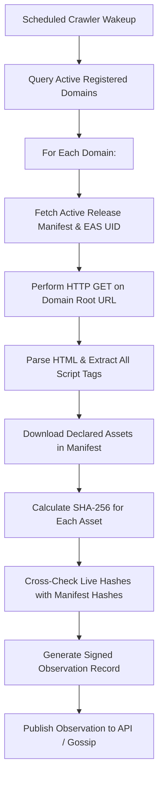

# Independent Verification & Crawler Algorithms — LUCENTRA

**Document ID:** LUC-WIT-004  
**Version:** 0.1.0  
**Status:** APPROVED  
**Last Updated:** 2026-11-09  

---

## 1. Purpose

This document details the crawling algorithm, asset fetching policies, and hash calculation pipeline implemented by autonomous witness daemons.

---

## 2. Crawler Execution Logic

---

## 3. Crawler Anti-Cloaking & User-Agent Rotation

To prevent targeted web servers from identifying and serving sanitized code strictly to witness nodes:
1. **User-Agent Emulation:** Nodes rotate standard consumer browser User-Agent strings (e.g. Chrome on Windows, Safari on macOS, Chrome on Android).
2. **Accept Headers:** Emulates full standard browser accept headers (`Accept: text/html,application/xhtml+xml...`).
3. **Multi-Region Crawling:** Crawls originate from diverse VPS and residential proxy networks across multiple geographical autonomous systems (ASNs).

---

## 4. Related Documents

- [docs/10-witness-network/WITNESS_ARCHITECTURE.md](WITNESS_ARCHITECTURE.md)
- [docs/10-witness-network/CONFLICT_RESOLUTION.md](CONFLICT_RESOLUTION.md)

---

## 5. References

- [Web Scraping Architecture and Anti-Fingerprinting Techniques](https://curl.se/libcurl/)

