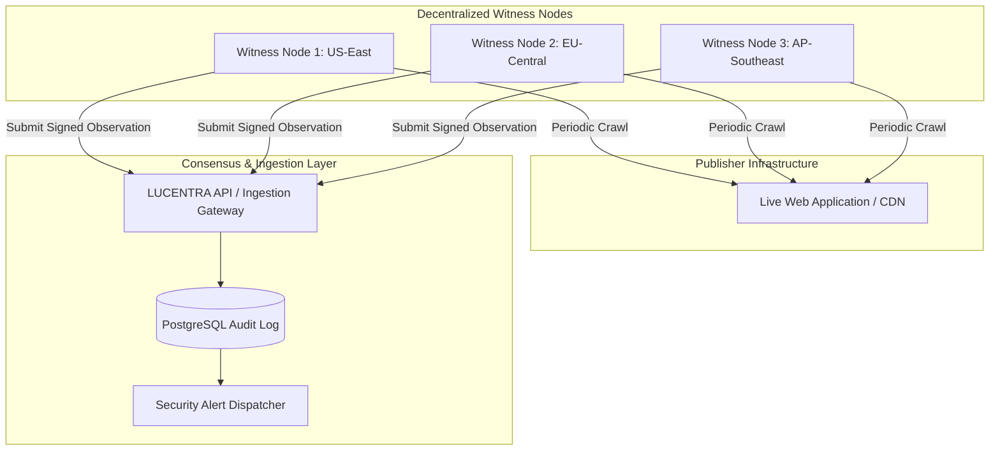

# Witness Network Architecture — LUCENTRA

**Document ID:** LUC-WIT-001  
**Version:** 0.1.0  
**Status:** APPROVED  
**Last Updated:** 2026-11-09  

---

## 1. Purpose

This document specifies the technical architecture of the LUCENTRA Independent Witness Network, defining node topologies, scheduled crawling mechanisms, and split-view attack defenses.

---

## 2. Network Topology

---

## 3. Core Operational Objectives

1. **Split-View Tampering Detection:** By auditing web deployments across geographically diverse autonomous nodes, the network detects attacks where malicious scripts are served selectively to target geographic regions or specific user IP subnets.
2. **Autonomous Auditing:** Witness nodes operate independently of publishers, continuously verifying that live deployed JavaScript files match on-chain EAS release attestations.
3. **Cryptographic Accountability:** All submitted observations are signed with the witness's secp256k1 private key, creating an immutable, non-repudiable audit trail.

---

## 4. Related Documents

- [docs/10-witness-network/WITNESS_IDENTITY.md](WITNESS_IDENTITY.md)
- [docs/10-witness-network/OBSERVATION_FORMAT.md](OBSERVATION_FORMAT.md)
- [docs/10-witness-network/CONFLICT_RESOLUTION.md](CONFLICT_RESOLUTION.md)

---

## 5. References

- [Certificate Transparency (RFC 6962)](https://www.rfc-editor.org/rfc/rfc6962.html)

