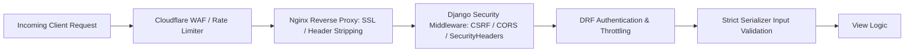

# API Security & Hardening Guide — LUCENTRA

**Document ID:** LUC-SEC-006  
**Version:** 0.1.0  
**Status:** APPROVED  
**Last Updated:** 2026-11-09  

---

## 1. Purpose

This document outlines the security controls, authentication safeguards, rate limiting, and network hardening measures applied to the Django REST Framework API.

---

## 2. API Security Architecture

---

## 3. Defense-in-Depth Measures

1. **Strict Input Validation:** All serializers enforce regex pattern matching, string length caps ($\le 255$ chars), and strict type casting.
2. **Rate Limiting:** Public endpoints throttled to 100 requests/minute per IP; challenge endpoints throttled to 10 requests/hour per IP.
3. **HTTP Security Headers:**
   - `Content-Security-Policy: default-src 'none'; frame-ancestors 'none';`
   - `X-Content-Type-Options: nosniff`
   - `Strict-Transport-Security: max-age=63072000; includeSubDomains; preload`
   - `X-Frame-Options: DENY`

---

## 4. Related Documents

- [docs/07-backend/API_SPECIFICATION.md](../07-backend/API_SPECIFICATION.md)
- [docs/11-security/THREAT_MODEL.md](THREAT_MODEL.md)

---

## 5. References

- [OWASP REST Security Cheat Sheet](https://cheatsheetseries.owasp.org/cheatsheets/REST_Security_Cheat_Sheet.html)
