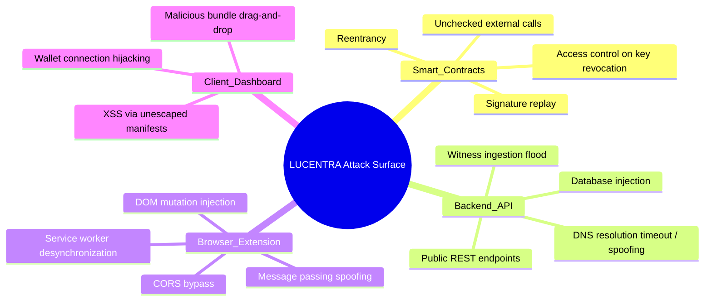

# Attack Surface Analysis — LUCENTRA

**Document ID:** LUC-SEC-003  
**Version:** 0.1.0  
**Status:** APPROVED  
**Last Updated:** 2026-11-09  

---

## 1. Purpose

This document identifies, analyzes, and quantifies the physical, network, contract, and browser attack surfaces of LUCENTRA.

---

## 2. Attack Surface Breakdown

---

## 3. Surface Reduction Strategies

1. **Smart Contracts:** Pure Solidity 0.8.24 without inline assembly in state transitions; 100% adherence to OpenZeppelin `Ownable2Step` and `ReentrancyGuard`.
2. **Backend API:** Stateless endpoints behind Cloudflare DDoS mitigation; Django ORM parameterized queries (zero raw SQL); strict CORS and Content-Type enforcement.
3. **Chrome Extension:** `activeTab` scoped permissions; `script-src 'self'` CSP; message validation checking `sender.id === chrome.runtime.id`.

---

## 4. Related Documents

- [docs/11-security/THREAT_MODEL.md](THREAT_MODEL.md)
- [docs/11-security/SMART_CONTRACT_SECURITY.md](SMART_CONTRACT_SECURITY.md)

---

## 5. References

- [OWASP Attack Surface Analysis Cheat Sheet](https://cheatsheetseries.owasp.org/cheatsheets/Attack_Surface_Analysis_Cheat_Sheet.html)

