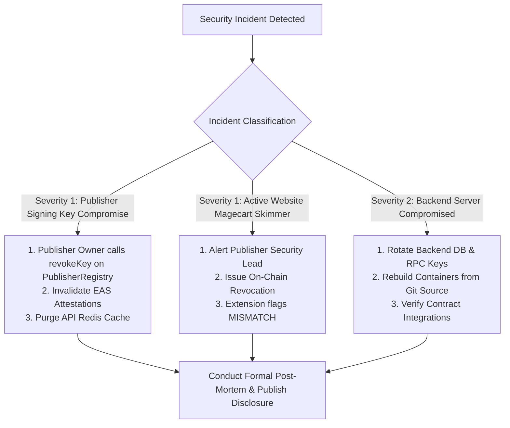

# Incident Response Plan — LUCENTRA

**Document ID:** LUC-SEC-009  
**Version:** 0.1.0  
**Status:** APPROVED  
**Last Updated:** 2026-11-09  

---

## 1. Purpose

This document establishes the emergency procedures, escalation paths, and remediation protocols for handling security incidents, including private key compromises, CDN breaches, and contract exploits.

---

## 2. Incident Classification & Response Workflows

---

## 3. Communication & Key Contacts

- **Security Team Dispatch:** `security@lucentra.io`
- **SLA:** Critical incidents acknowledged within 15 minutes; on-chain key revocation executed within 1 hour.

---

## 4. Related Documents

- [docs/05-cryptography/KEY_ROTATION_AND_REVOCATION.md](../05-cryptography/KEY_ROTATION_AND_REVOCATION.md)
- [SECURITY.md](../../SECURITY.md)

---

## 5. References

- [NIST SP 800-61: Computer Security Incident Handling Guide](https://csrc.nist.gov/publications/detail/sp/800-61/rev-2/final)
