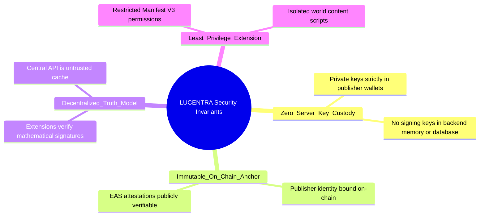

# Security Overview & Guarantees — LUCENTRA

**Document ID:** LUC-SEC-001  
**Version:** 0.1.0  
**Status:** APPROVED  
**Last Updated:** 2026-11-09  

---

## 1. Purpose

This document provides the foundational security architecture and threat landscape overview for LUCENTRA, synthesizing the security invariants and trust guarantees established across smart contracts, APIs, and client extensions.

---

## 2. Global Security Invariants

---

## 3. Cryptographic Assurance Summary

- **Collision Resistance:** Asset and manifest hashing utilize SHA-256 (NIST FIPS 180-4), offering 128-bit collision resistance and 256-bit pre-image resistance.
- **Non-Repudiation:** EIP-712 structured signatures ensure that publishers cannot repudiate authorized releases.
- **Deterministic Serialization:** JSON Canonicalization Scheme (RFC 8785) guarantees zero signature malleability.

---

## 4. Related Documents

- [docs/11-security/THREAT_MODEL.md](THREAT_MODEL.md)
- [docs/11-security/ATTACK_SURFACE_ANALYSIS.md](ATTACK_SURFACE_ANALYSIS.md)
- [docs/11-security/SMART_CONTRACT_SECURITY.md](SMART_CONTRACT_SECURITY.md)

---

## 5. References

- [NIST SP 800-207: Zero Trust Architecture](https://csrc.nist.gov/publications/detail/sp/800-207/final)

