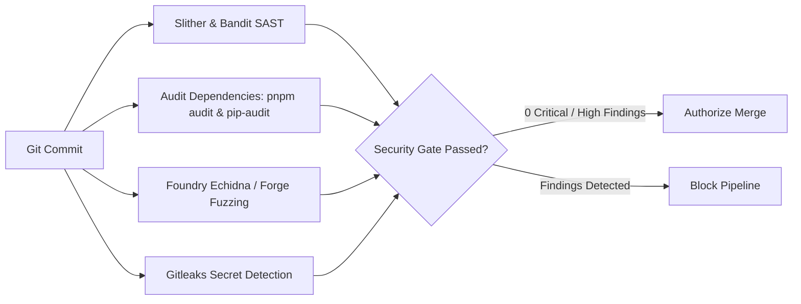

# Security Testing & Static Analysis — LUCENTRA

**Document ID:** LUC-TST-005  
**Version:** 0.1.0  
**Status:** APPROVED  
**Last Updated:** 2026-11-09  

---

## 1. Purpose

This document outlines the automated security scanning, static analysis (SAST), dependency auditing, and fuzz testing toolchains for LUCENTRA.

---

## 2. Automated Security Tooling Matrix

---

## 3. Toolchain Configuration

1. **Slither (Solidity SAST):** `slither . --checklist --filter-paths "lib/"`
2. **Bandit (Python SAST):** `bandit -r services/backend/ -ll`
3. **Gitleaks (Secret Scanning):** Automated pre-commit hook preventing commits containing secp256k1 private keys, AWS tokens, or database passwords.

---

## 4. Related Documents

- [docs/11-security/SECURITY_OVERVIEW.md](../11-security/SECURITY_OVERVIEW.md)
- [docs/11-security/SECURITY_AUDIT_CHECKLIST.md](../11-security/SECURITY_AUDIT_CHECKLIST.md)

---

## 5. References

- [Slither Static Analyzer](https://github.com/crytic/slither)
- [Bandit Security Linter](https://bandit.readthedocs.io/)

