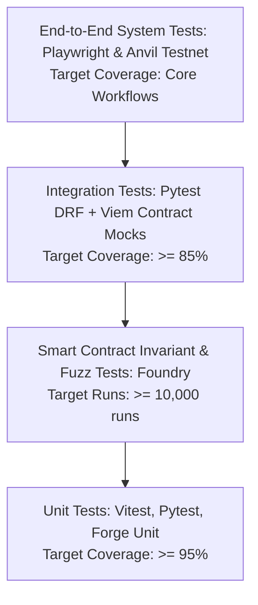

# Testing Strategy & Test Pyramid — LUCENTRA

**Document ID:** LUC-TST-001  
**Version:** 0.1.0  
**Status:** APPROVED  
**Last Updated:** 2026-11-09  

---

## 1. Purpose

This document specifies the global testing strategy, automated test harness architecture, coverage requirements, and quality gates for LUCENTRA.

---

## 2. Test Pyramid & Coverage Targets

---

## 3. Subsystem Test Frameworks

| Subsystem | Primary Testing Framework | Tooling & Runners | Minimum Branch Coverage |
| :--- | :--- | :--- | :--- |
| **Smart Contracts** | Foundry (`forge test`) | Forge, Anvil, Cast | 100% Branch Coverage |
| **Backend API** | Pytest (`pytest-django`) | FactoryBoy, Mock, Redis Mock | 90% Line Coverage |
| **Frontend Dashboard**| Vitest & React Testing Library | MSW (Mock Service Worker) | 85% Line Coverage |
| **Browser Extension** | Playwright / Chrome WebDriver | Headless Chromium, Mock Server | 90% Verification Logic |
| **Protocol / Canonical**| Cross-Language Test Harness | Node.js, Python, Go | 100% Deterministic Pass |

---

## 4. Verification Gate Rule

No feature may be marked `TESTED` or `VERIFIED` in `DEVELOPMENT_STATUS.md` without automated CI test execution output confirming zero test failures.

---

## 5. Related Documents

- [docs/12-testing/UNIT_TESTING.md](UNIT_TESTING.md)
- [docs/12-testing/CONTRACT_TESTING.md](CONTRACT_TESTING.md)
- [docs/12-testing/TEST_CASES.md](TEST_CASES.md)

---

## 6. References

- [Foundry Testing Guide](https://book.getfoundry.sh/forge/tests)
- [Martin Fowler: Practical Test Pyramid](https://martinfowler.com/articles/practical-test-pyramid.html)
