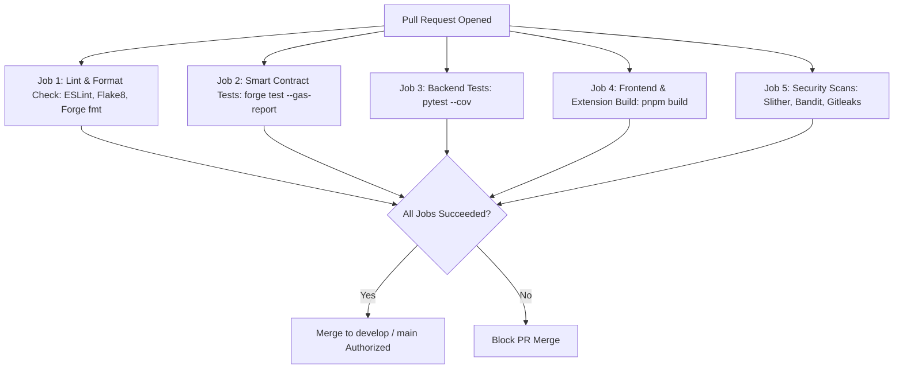

# Continuous Integration & Deployment (CI/CD) — LUCENTRA

**Document ID:** LUC-OPS-003  
**Version:** 0.1.0  
**Status:** APPROVED  
**Last Updated:** 2026-11-09  

---

## 1. Purpose

This document specifies the automated GitHub Actions CI/CD workflows governing code validation, test execution, container builds, and deployment gates.

---

## 2. GitHub Actions Pipeline Architecture

---

## 3. Workflow Definitions (`.github/workflows/ci.yml`)

- Runs on `push` to `main`, `develop`, and all pull requests.
- Concurrency groups cancel outdated runs on subsequent pushes to the same PR.
- Fails immediately if branch coverage drops below agreed thresholds.

---

## 4. Related Documents

- [docs/13-devops/BUILD_AND_DEPLOYMENT.md](BUILD_AND_DEPLOYMENT.md)
- [CONTRIBUTING.md](../../CONTRIBUTING.md)

---

## 5. References

- [GitHub Actions Documentation](https://docs.github.com/en/actions)

