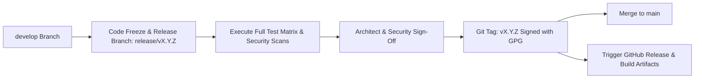

# DevOps Release Management & Tagging — LUCENTRA

**Document ID:** LUC-OPS-008  
**Version:** 0.1.0  
**Status:** APPROVED  
**Last Updated:** 2026-11-09  

---

## 1. Purpose

This document specifies the DevOps procedures for tagging Git releases, managing semantic version increments, building production bundles, and publishing release notes.

---

## 2. Release Tagging & Promotion Workflow

---

## 3. Release Checklist

1. [ ] All milestone tickets closed in `TASK_BACKLOG.md`.
2. [ ] `CHANGELOG.md` updated with release highlights, breaking changes, and bugfixes.
3. [ ] Smart contract verification verified on block explorers.
4. [ ] Chrome Extension zip artifact tested against Chrome Web Store automated validator.

---

## 4. Related Documents

- [docs/17-releases/RELEASE_NOTES_TEMPLATE.md](../17-releases/RELEASE_NOTES_TEMPLATE.md)
- [CHANGELOG.md](../../CHANGELOG.md)

---

## 5. References

- [Git Tagging Guide](https://git-scm.com/book/en/v2/Git-Basics-Tagging)
