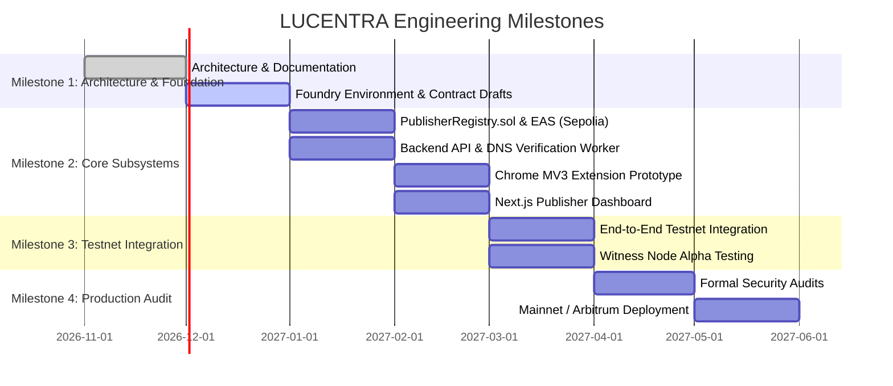

# Engineering Development Roadmap — LUCENTRA

**Document ID:** LUC-PM-001  
**Version:** 0.1.0  
**Status:** APPROVED  
**Last Updated:** 2026-11-09  

---

## 1. Purpose

This document provides the high-level engineering roadmap, quarterly milestones, and subsystem dependencies for developing and deploying the LUCENTRA verification platform.

---

## 2. Engineering Milestones Timeline

---

## 3. Related Documents

- [docs/14-project-management/MILESTONES.md](MILESTONES.md)
- [docs/14-project-management/SPRINT_PLAN.md](SPRINT_PLAN.md)
- [docs/14-project-management/DEVELOPMENT_STATUS.md](DEVELOPMENT_STATUS.md)

---

## 4. References

- [LUCENTRA Product Requirements](../01-product-management/PRODUCT_REQUIREMENTS.md)

