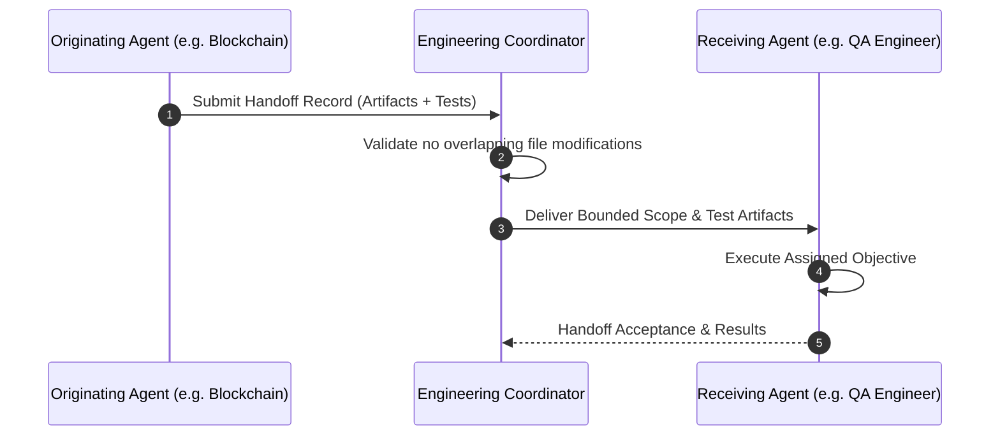

# Agent Handoff Protocol — LUCENTRA

**Document ID:** LUC-GOV-011  
**Version:** 0.1.0  
**Status:** APPROVED  
**Last Updated:** 2026-11-09  

---

## 1. Purpose

This document defines the formal protocol for transferring execution context, deliverables, test results, and unresolved questions between specialized AI engineering agents.

---

## 2. Handoff Protocol Requirements

When an agent completes a task and delegates to another agent, the handoff payload must conform to `docs/templates/AGENT_HANDOFF_TEMPLATE.md` and include:

1. **Originating Agent & Role:** Identify sender role.
2. **Target Agent & Role:** Identify receiving role.
3. **Summary of Work Completed:** Explicit list of created or modified files.
4. **Current Status & Artifacts:** Git commit, contract addresses on Anvil, or test output.
5. **Exact Scope of Responsibility for Target Agent:** Clear, bounded objective.
6. **Known Blockers or Caveats:** Any technical debt or unresolved edge cases.

---

## 3. Standard Handoff Flow

---

## 4. Related Documents

- [docs/templates/AGENT_HANDOFF_TEMPLATE.md](../templates/AGENT_HANDOFF_TEMPLATE.md)
- [docs/15-ai-agent-governance/AGENT_WORKFLOWS.md](AGENT_WORKFLOWS.md)
