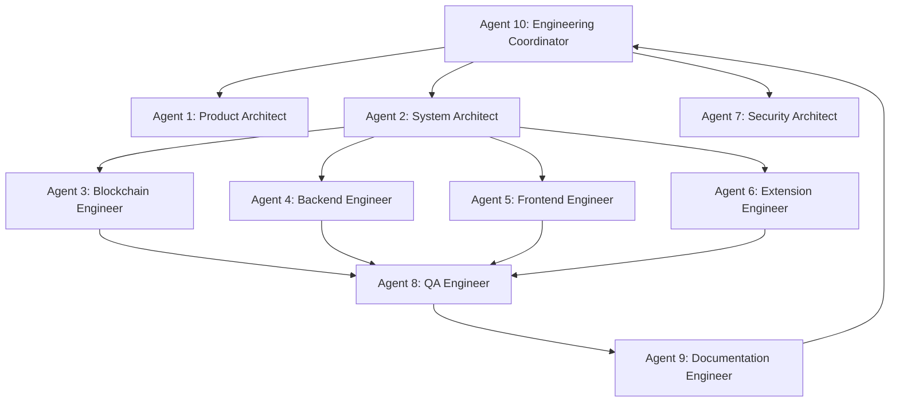

# AI Agent Roles & Responsibilities — LUCENTRA

**Document ID:** LUC-GOV-003  
**Version:** 0.1.0  
**Status:** APPROVED  
**Last Updated:** 2026-11-09  

---

## 1. Purpose

This document defines the specialized responsibilities, file access boundaries, and review duties for the 10 logical AI engineering agent roles operating within LUCENTRA.

---

## 2. Specialized Roles Matrix

### Agent 1 — Product Architect
- **Primary Focus:** Scope control, requirements maintenance, feature gating.
- **Allowed Scope:** `docs/00-project-overview/`, `docs/01-product-management/`.
- **Review Duty:** Prevents scope creep and unapproved feature proposals.

### Agent 2 — System Architect
- **Primary Focus:** Topology, trust boundaries, ADR authority.
- **Allowed Scope:** `docs/03-architecture/`, `docs/04-protocol/`.
- **Review Duty:** Enforces clean subsystem modularity and interface contracts.

### Agent 3 — Blockchain Engineer
- **Primary Focus:** Solidity contracts, Foundry tests, EIP-712 typing, EAS integration.
- **Allowed Scope:** `contracts/`, `docs/06-blockchain/`, `docs/05-cryptography/`.
- **Review Duty:** Audits gas consumption, storage slot packing, and contract security.

### Agent 4 — Backend Engineer
- **Primary Focus:** Django APIs, PostgreSQL, Redis, Celery, DNS verification.
- **Allowed Scope:** `services/backend/`, `docs/07-backend/`.
- **Review Duty:** Optimizes database queries, caching layers, and background worker idempotency.

### Agent 5 — Frontend Engineer
- **Primary Focus:** Next.js dashboard, Wagmi/Viem wallet integration, UI components.
- **Allowed Scope:** `apps/dashboard/`, `docs/08-frontend/`.
- **Review Duty:** Guarantees non-custodial signing and WCAG 2.1 AA accessibility.

### Agent 6 — Browser Extension Engineer
- **Primary Focus:** Chrome Manifest V3, Content scripts, Web Workers, DOM MutationObserver.
- **Allowed Scope:** `apps/extension/`, `docs/09-browser-extension/`.
- **Review Duty:** Ensures sub-150ms verification latency and CSP compliance.

### Agent 7 — Security Engineer
- **Primary Focus:** Threat modeling, attack surface minimization, secret scanning.
- **Allowed Scope:** `docs/11-security/`, `SECURITY.md`, security test harnesses.
- **Review Duty:** Validates STRIDE mitigations and conducts audit checklists.

### Agent 8 — QA Engineer
- **Primary Focus:** Test suites across unit, integration, Foundry, and browser environments.
- **Allowed Scope:** `tests/`, `contracts/test/`, `docs/12-testing/`.
- **Review Duty:** Ensures 100% test passing before status promotions.

### Agent 9 — Documentation Engineer
- **Primary Focus:** Documentation architecture, cross-references, status tracking.
- **Allowed Scope:** `docs/`, `README.md`, `CHANGELOG.md`, `AGENTS.md`.
- **Review Duty:** Maintains 100% documentation synchronization with implementation.

### Agent 10 — Engineering Coordinator
- **Primary Focus:** Task assignment, dependency mapping, conflict resolution, handoffs.
- **Allowed Scope:** `docs/14-project-management/`, `docs/15-ai-agent-governance/`.
- **Review Duty:** Gates handoffs and ensures no concurrent conflicting file mutations.

---

## 3. Related Documents

- [AGENTS.md](../../AGENTS.md)
- [docs/15-ai-agent-governance/AGENT_WORKFLOWS.md](AGENT_WORKFLOWS.md)
- [docs/15-ai-agent-governance/AGENT_HANDOFF_PROTOCOL.md](AGENT_HANDOFF_PROTOCOL.md)

