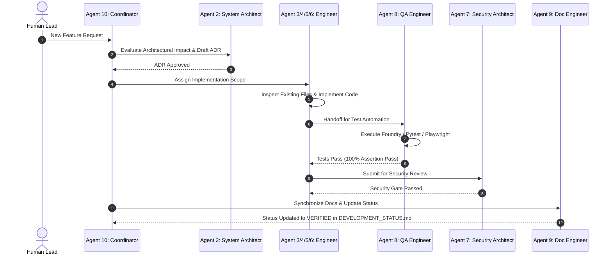

# Multi-Agent Engineering Workflows — LUCENTRA

**Document ID:** LUC-GOV-004  
**Version:** 0.1.0  
**Status:** APPROVED  
**Last Updated:** 2026-11-09  

---

## 1. Purpose

This document establishes the collaboration workflows, delegation rules, and feedback loops connecting specialized AI agents during feature development and refactoring.

---

## 2. Standard Feature Development Lifecycle

---

## 3. Related Documents

- [docs/15-ai-agent-governance/AGENT_ROLES.md](AGENT_ROLES.md)
- [docs/15-ai-agent-governance/AGENT_HANDOFF_PROTOCOL.md](AGENT_HANDOFF_PROTOCOL.md)
