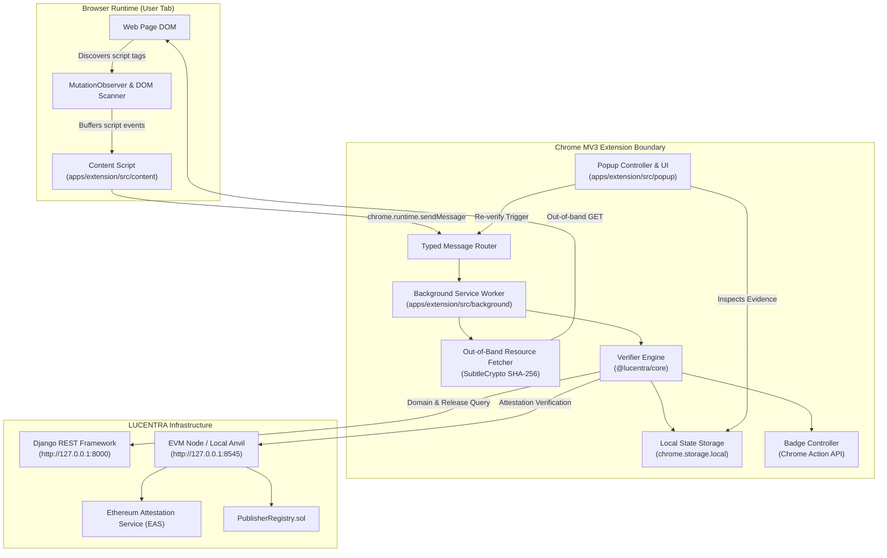
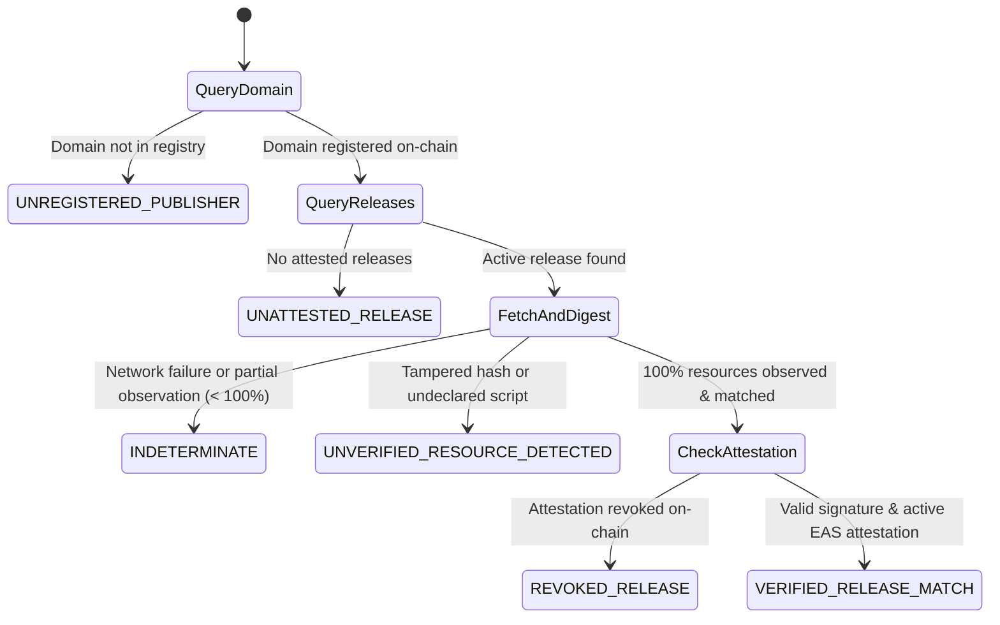

# LUCENTRA Chrome Extension Architecture

**Document ID:** LUC-EXT-001  
**Version:** 0.1.0  
**Status:** VERIFIED  
**Component:** `apps/extension`  
**Last Updated:** 2026-11-16  

---

## 1. Architectural Overview

The **LUCENTRA Chrome Extension** is an independent, non-custodial browser verification client built upon Google Chrome's **Manifest V3 (MV3)** architecture.

The extension continuously and non-invasively evaluates the cryptographic identity of website publishers and verifies whether JavaScript resources delivered to the browser match on-chain attested, cryptographically signed release manifests.

---

## 2. Core Subsystems

### 2.1 Content Script & DOM Resource Observation (`apps/extension/src/content/`)
- Injected into all web pages at `document_start`.
- Operates within an isolated JavaScript execution context without interfering with host page variables.
- Utilizes `MutationObserver` on `document.documentElement` observing child insertions and `src` attribute modifications.
- Debounces script discovery notifications (400ms) to avoid IPC message thrashing during heavy page loads.
- Strictly ignores inline scripts and non-HTTP/HTTPS sources, while cataloging all external `<script src="...">` elements.

### 2.2 Background Service Worker & Message Router (`apps/extension/src/background/`)
- Runs as an asynchronous, event-driven Manifest V3 service worker (`type: "module"`).
- Implements strict typed message schemas (`ExtensionMessage`) with runtime validation guards (`isExtensionMessage`).
- Coordinates tab lifecycle events (`chrome.tabs.onUpdated`, `chrome.tabs.onRemoved`), resetting state upon new URL navigation.
- Updates visual icon badges (`✓`, `!`, `?`, `✕`, `○`, `△`) dynamically reflecting the verification state of the focused tab.

### 2.3 Out-of-Band Resource Fetcher (`apps/extension/src/services/resource-fetcher.ts`)
- Retrieves JavaScript resource bytes independently of the browser's speculative script cache using `fetch(url, { credentials: 'omit', cache: 'no-store' })`.
- Enforces strict Server-Side Request Forgery (SSRF) and Private Network Access prevention:
  - Blocks RFC 1918 private IPv4 subnets (`10.0.0.0/8`, `172.16.0.0/12`, `192.168.0.0/16`).
  - Blocks AWS/GCP/Azure link-local cloud metadata endpoints (`169.254.169.254`).
  - Configurable localhost bypass (`127.0.0.1`, `localhost`) strictly enabled for development environments.
- Enforces strict resource size boundaries (5 MiB per script) and network timeouts (10 seconds via `AbortController`).
- Computes SHA-256 hashes using the standard W3C `SubtleCrypto` (`crypto.subtle.digest`) API on raw `ArrayBuffer` payloads.

### 2.4 Cryptographic Verifier Engine (`apps/extension/src/services/verifier-engine.ts`)
- Leverages the battle-tested `@lucentra/core` cryptographic verification pipeline.
- Performs end-to-end evaluation across the Six Formal Protocol States:
  1. `VERIFIED_RELEASE_MATCH`
  2. `UNVERIFIED_RESOURCE_DETECTED`
  3. `INDETERMINATE`
  4. `REVOKED_RELEASE`
  5. `UNREGISTERED_PUBLISHER`
  6. `UNATTESTED_RELEASE`
- **Release Completeness Invariant:** If a declared release manifest lists $N$ resources, but fewer than $N$ resources were observed in the active page DOM, the evaluation **MUST NOT** return `VERIFIED_RELEASE_MATCH`. It evaluates strictly to `INDETERMINATE`.

### 2.5 Trust-Status Popup UI (`apps/extension/src/popup/`)
- Clean, authoritative dark navy/charcoal styling (`#0B0F19`).
- Displays instant visual verification status, publisher Ethereum address, release version, SHA-256 manifest digest, and EAS Attestation UID.
- Detailed collapsible per-resource audit table indicating matching, missing, or undeclared scripts.
- Prominent and inescapable **Honest Verification Security Disclosure**.

---

## 3. Protocol State Machine

---

## 4. Security Boundaries & Invariants

1. **Zero Private Key Storage:** The extension contains zero cryptographic signing keys, mnemonics, or administrative secrets.
2. **Read-Only Verification:** The extension does not modify the webpage DOM, does not rewrite script tags, and does not block script execution.
3. **Out-of-Band Integrity:** Verification reflects out-of-band fetched byte integrity against declared release manifests. It does not inspect in-memory JIT execution state within the V8 engine.
4. **Honest Security Posture:** The extension never claims a website is "safe", "malware-free", or "legitimate". It reports only cryptographic provenance and byte-exact resource integrity.
