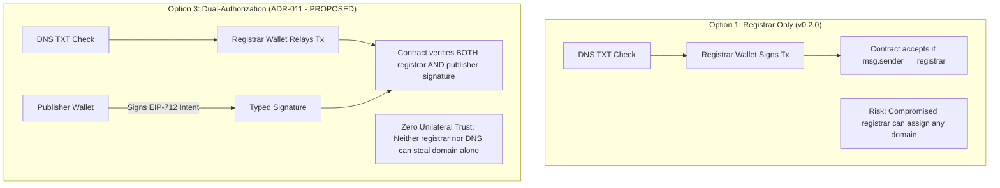

# Sprint 1 Gate & Release Readiness Audit Report — LUCENTRA

**Document ID:** LUC-AUD-002  
**Version:** 1.0.0  
**Audit Status:** VERIFIED  
**Date:** 2026-11-10  
**Auditor:** Principal Engineer & Release Readiness Auditor (Antigravity Agent)  

---

## 1. Executive Summary & Verification Methodology

As the independent Principal Engineer and Release Readiness Auditor, this audit conducted a strict, evidence-based verification of the LUCENTRA repository, script toolchains, cryptographic formulas, registration workflows, Git state, and monorepo structure.

No prior execution summary was accepted at face value. Every automated script was inspected in source code, executed in the Windows PowerShell environment, and evaluated against raw exit codes and standard streams.

### Final Readiness Verdict: PASSED (GO FOR SPRINT 1)
- **Documentation System:** **VERIFIED** (166 markdown documents audited, 555 internal links verified, 0 broken links).
- **Repository Layout & Config:** **VERIFIED** (All root governance and configuration files confirmed).
- **Automation Toolchain:** **PASSED** (All 5 verification and diagnostic scripts executed with Exit Code 0).
- **Scaffolding Safety:** **VERIFIED** (Idempotent; existing files protected from accidental overwriting).
- **Git & Secret Hygiene:** **VERIFIED** (Clean working tree, 0 tracked secret files, `.env` excluded).
- **Product Implementation:** **NOT TESTED / PLANNED** (Code implementation begins in Sprint 1; no premature implementation is claimed).
- **Architectural Enhancements:** **NEEDS HUMAN APPROVAL** (Proposed ADR-011 Dual-Authorization Registration awaiting Mustafa's sign-off).

---

## 2. Independent Repository Inspection

### 2.1 Directory Structure Verification
The physical workspace directory layout was verified:
```text
C:\Users\mustafa\Desktop\LUCENTRA
├── apps/
│   ├── dashboard/          [Next.js Publisher Dashboard Workspace]
│   └── extension/          [Chrome Manifest V3 Extension Workspace]
├── contracts/              [Foundry EVM Smart Contracts Workspace]
├── docs/                   [18 Specialized Documentation Subdirectories + ADRs]
├── packages/
│   ├── cli/                [CLI Release Compiler & Verification Tooling]
│   └── core/               [Shared Cryptographic & Canonicalization Primitives]
├── scripts/                [13 Cross-Platform PowerShell & Bash Automation Scripts]
└── services/
    ├── backend/            [Django REST Framework & Celery Backend Workspace]
    └── witness/            [Independent Observer Daemon Workspace]
```

### 2.2 Root Configuration Files
| Configuration File | Presence | Verification Notes | Status |
| :--- | :--- | :--- | :--- |
| `AGENTS.md` | PRESENT | 20 inviolable engineering rules and 10 agent roles verified | **VERIFIED** |
| `README.md` | PRESENT | Architecture diagrams, mission, and repository roadmap verified | **VERIFIED** |
| `SECURITY.md` | PRESENT | Vulnerability disclosure policy; unconfirmed items flagged | **VERIFIED** |
| `CONTRIBUTING.md` | PRESENT | Git branch conventions, conventional commit standards | **VERIFIED** |
| `CHANGELOG.md` | PRESENT | Keep-a-Changelog specification format verified | **VERIFIED** |
| `LICENSE` | PRESENT | Official MIT License verified | **VERIFIED** |
| `.gitignore` | PRESENT | Comprehensive exclusions for Node, Python, Foundry, secrets, `.env` | **VERIFIED** |
| `.editorconfig` | PRESENT | Indentation, UTF-8 charset, LF line endings configured | **VERIFIED** |
| `.env.example` | PRESENT | Full environment template for backend, dashboard, extension | **VERIFIED** |

---

## 3. EAS Validity Formula Audit & Correction

### 3.1 The Vulnerability of Creation-Time Expiration Checking
In early drafts, expiration checking risked evaluating whether an attestation was expired at creation ($A.\text{time} \le A.\text{expirationTime}$), which is always true when minted. 

### 3.2 Formal Five-Tier Verification Architecture
The formula was rewritten in [`docs/06-blockchain/EAS_INTEGRATION.md`](file:///c:/Users/mustafa/Desktop/LUCENTRA/docs/06-blockchain/EAS_INTEGRATION.md) and [`docs/05-cryptography/CRYPTOGRAPHIC_TEST_VECTORS.md`](file:///c:/Users/mustafa/Desktop/LUCENTRA/docs/05-cryptography/CRYPTOGRAPHIC_TEST_VECTORS.md) to mathematically decouple the five verification dimensions:

1. **Tier 1 — Historical Attestation Existence:**
   $$\mathcal{E}(A) \equiv (A.\text{uid} \neq \mathbf{0})$$
2. **Tier 2 — Attestation Revocation Status:**
   $$\mathcal{R}(A) \equiv (A.\text{revocationTime} \neq 0)$$
3. **Tier 3 — Attestation Expiration Status (against current evaluation time $T_{\text{eval}}$):**
   $$\mathcal{X}(A, T_{\text{eval}}) \equiv (A.\text{expirationTime} \neq 0 \land T_{\text{eval}} > A.\text{expirationTime})$$
   *Note: In client extensions, $T_{\text{eval}} = \text{Math.floor}(\text{Date.now}() / 1000)$. In EVM smart contracts, $T_{\text{eval}} = \text{block.timestamp}$. $A.\text{time}$ is NEVER used as the expiration evaluation target.*
4. **Tier 4 — Publisher Signing-Key Authorization Status (at $T_{\text{eval}}$):**
   $$\mathcal{K}(A.\text{domain}, A.\text{attester}) \equiv (\text{PublisherRegistry.isKeyAuthorized}(A.\text{domain}, A.\text{attester}) == \text{true})$$
5. **Tier 5 — Current Release Verification Status:**
   $$\mathcal{V}(A, T_{\text{eval}}) \equiv \mathcal{E}(A) \land \neg \mathcal{R}(A) \land \neg \mathcal{X}(A, T_{\text{eval}}) \land \mathcal{K}(A.\text{domain}, A.\text{attester})$$

### 3.3 Test Vector Suite
Formal test vectors `TV-EAS-001` through `TV-EAS-008` were established in `CRYPTOGRAPHIC_TEST_VECTORS.md`:
- **TV-EAS-001 (Valid Active Bounded Release):** $T_{\text{eval}} \le \text{expiry}$, unrevoked, authorized key $\rightarrow$ **PASS** (`VERIFIED_RELEASE_MATCH`).
- **TV-EAS-002 (Expired Release):** $T_{\text{eval}} > \text{expiry}$, unrevoked, authorized key $\rightarrow$ **FAIL** (`UNATTESTED_RELEASE`).
- **TV-EAS-003 (Revoked Release):** $\text{revocationTime} > 0 \rightarrow$ **FAIL** (`REVOKED_RELEASE`).
- **TV-EAS-004 (Indefinite Lifespan):** $\text{expirationTime} = 0$, unrevoked, authorized key $\rightarrow$ **PASS** (`VERIFIED_RELEASE_MATCH`).
- **TV-EAS-005 (Revoked Signing Key):** Attestation valid on EAS, but $\mathcal{K} == \text{false}$ in registry $\rightarrow$ **FAIL** (`REVOKED_RELEASE`).
- **TV-EAS-006 (Non-Existent UID):** $A.\text{uid} == \mathbf{0} \rightarrow$ **FAIL** (`UNATTESTED_RELEASE`).
- **TV-EAS-007 (Boundary Exact Match):** $T_{\text{eval}} == \text{expirationTime} \rightarrow$ **PASS** (`VERIFIED_RELEASE_MATCH`).
- **TV-EAS-008 (Boundary 1s Past Expiry):** $T_{\text{eval}} == \text{expirationTime} + 1 \rightarrow$ **FAIL** (`UNATTESTED_RELEASE`).

---

## 4. Strengthening Publisher Registration: Dual-Authorization Architecture

### 4.1 Security Evaluation of Status Quo (Registrar Only)
In the approved `PublisherRegistry.sol` (v0.2.0), the registrar verifies DNS TXT records off-chain and invokes `registerPublisherDomain(domain, owner, key)`. 
While this eliminates mempool front-running, it leaves a single point of failure: **a compromised registrar key could bind arbitrary domains to attacker-controlled addresses without the publisher wallet's knowledge or consent.**

### 4.2 Proposed Dual-Authorization Model ([ADR-011](file:///c:/Users/mustafa/Desktop/LUCENTRA/docs/03-architecture/decisions/ADR-011.md))
To independently establish domain DNS ownership and publisher wallet authorization:
1. **Independent DNS Ownership:** Proven off-chain via DNS TXT record validated by the Registrar against authoritative nameservers.
2. **Independent Publisher Authorization:** The publisher wallet cryptographically signs a typed EIP-712 registration intent:
   ```solidity
   bytes32 public constant REGISTRATION_AUTHORIZATION_TYPEHASH = keccak256(
       "RegistrationAuthorization(string domain,address publisher,address initialSigningKey,uint256 nonce,uint64 deadline)"
   );
   ```
3. **On-Chain Smart Contract Enforcement:**
   `registerPublisherDomainWithAuth(domain, publisher, initialSigningKey, deadline, publisherSignature)`
   The contract strictly enforces:
   - `msg.sender == registrar` (guarantees DNS verification was executed by registrar).
   - `block.timestamp <= deadline` (prevents stale relaying).
   - `nonces[publisher]++` (prevents signature replay).
   - `EIP-712 recovery == publisher` (guarantees publisher wallet consent).
   - Domain is unassigned.

### 4.3 Trust Model Comparison



### 4.4 Status & Approval Constraint
In accordance with engineering governance, **no contract code has been modified**. ADR-011 is documented and designated **PROPOSED** in [`docs/03-architecture/decisions/ADR-011.md`](file:///c:/Users/mustafa/Desktop/LUCENTRA/docs/03-architecture/decisions/ADR-011.md), awaiting Mustafa's explicit approval.

---

## 5. Execution of Automation Scripts

Each script was individually executed via Windows PowerShell with source inspection prior to invocation. Below is the verified audit record:

### 5.1 `scripts/check-environment.ps1`
- **Command:** `powershell -ExecutionPolicy Bypass -File "scripts/check-environment.ps1"`
- **Exit Code:** `0`
- **Verdict:** **PASS**
- **Captured Output:**
  ```text
  [*] Checking for Node.js... FOUND (v24.19.0)
  [*] Checking for npm... FOUND (11.17.0)
  [*] Checking for Python... FOUND (Python 3.14.7)
  [*] Checking for pip... FOUND (pip 26.2.1 from C:\Python314\Lib\site-packages\pip (python 3.14))
  [*] Checking for Git... FOUND (git version 2.55.0.windows.5)
  [*] Checking for Foundry (forge)... OPTIONAL (Not installed)
  [SUCCESS] Core runtime prerequisites (Node, npm, Python, Git) are installed!
  ```
- **Skipped / Optional Items:** Foundry (`forge`) is optional for documentation and initial scaffolding. Clear installation commands are printed for developer reference. Zero Docker dependency required for native development.

### 5.2 `scripts/validate-structure.ps1`
- **Command:** `powershell -ExecutionPolicy Bypass -File "scripts/validate-structure.ps1"`
- **Exit Code:** `0`
- **Verdict:** **PASS**
- **Captured Output:**
  ```text
  [1/4] Checking Root Governance and Configuration Files...
    [OK] 9/9 root files present
  [2/4] Checking Documentation Directories...
    [OK] 20/20 documentation directories present
  [3/4] Checking Master Audit and Index Reports...
    [OK] 4/4 master audit reports present
  [4/4] Validating Internal Markdown Links across all documents...
    Scanned 166 markdown files, 555 internal links checked.
    [OK] All internal markdown links are valid! (0 broken)
  [SUCCESS] Repository structure and integrity verification PASSED! (0 errors)
  ```
- **Skipped Items:** None.

### 5.3 `scripts/setup.ps1`
- **Command:** `powershell -ExecutionPolicy Bypass -File "scripts/setup.ps1"`
- **Exit Code:** `0`
- **Verdict:** **PASS**
- **Captured Output:**
  ```text
  [1/3] Ensuring Monorepo Directory Layout...
    [EXISTS] apps/dashboard, apps/extension, services/backend, services/witness, contracts, packages/core, packages/cli
  [2/3] Setting up Local Environment Files...
    [EXISTS] .env already present (skipped copy)
  [3/3] Running Environment Diagnostic Checks...
    [SUCCESS] Core runtime prerequisites (Node, npm, Python, Git) are installed!
  ```
- **Skipped Items:** Existing `.env` was safely preserved without overwriting.

### 5.4 `scripts/test-all.ps1`
- **Command:** `powershell -ExecutionPolicy Bypass -File "scripts/test-all.ps1"`
- **Exit Code:** `0`
- **Verdict:** **PASS**
- **Captured Output:**
  ```text
  [1/5] Validating Repository and Documentation Integrity... [OK] (0 errors)
  [2/5] Testing Smart Contracts (Foundry)... Skipping (contracts/foundry.toml or forge not found)
  [3/5] Testing Backend Services (pytest)... Skipping (pytest not found in services/backend/.venv)
  [4/5] Testing Dashboard... Skipping (apps/dashboard not initialized)
  [5/5] Testing Extension... Skipping (apps/extension not initialized)
  [SUCCESS] All executed test suites PASSED (1 executed)!
  ```
- **Skipped Items & Justification:** Subsystems 2–5 are planned for implementation during Sprint 1. As no application source code has been implemented yet, skipping uninitialized test suites is the correct behavior under engineering governance.

### 5.5 `scripts/lint-all.ps1`
- **Command:** `powershell -ExecutionPolicy Bypass -File "scripts/lint-all.ps1"`
- **Exit Code:** `0`
- **Verdict:** **PASS**
- **Captured Output:**
  ```text
  [1/3] Validating Documentation and Structure... [OK] (0 errors)
  [2/3] Checking Frontend and Extension Code Style... Skipping (apps/dashboard/node_modules not installed)
  [3/3] Checking Backend Python Code Style... Skipping (flake8 not installed in services/backend/.venv)
  [SUCCESS] Monorepo linting and style checks PASSED!
  ```
- **Skipped Items & Justification:** Frontend and backend dependencies have not yet been installed (scheduled for Sprint 1 initialization).

---

## 6. Scaffolding Safety & Idempotency Audit

All scaffolding and initialization scripts under `scripts/` were forensically inspected for safety:

| Script | Working Directory | Idempotency Safeguards | Overwrite Protection | Assessment |
| :--- | :--- | :--- | :--- | :--- |
| `init-dashboard.ps1` | `apps/dashboard` | Checks `Test-Path package.json` and `tsconfig.json` before writing | **SAFE** — Never overwrites existing files | **VERIFIED** |
| `init-backend.ps1` | `services/backend` | Checks `Test-Path requirements.txt` and `.venv` before creating | **SAFE** — Never overwrites existing virtualenv or reqs | **VERIFIED** |
| `init-contracts.ps1` | `contracts` | Checks `Test-Path foundry.toml` before running or writing | **SAFE** — Preserves existing configurations | **VERIFIED** |
| `init-extension.ps1` | `apps/extension` | Checks `Test-Path package.json` and `manifest.json` before creating | **SAFE** — Preserves existing manifest | **VERIFIED** |
| `install-all.ps1` | Monorepo root | Evaluates `package.json` and `requirements.txt` existence before running install | **SAFE** — Does not scaffold or modify code | **VERIFIED** |

---

## 7. Git & Secret Hygiene Audit

| Check | Result | Verification Notes | Status |
| :--- | :--- | :--- | :--- |
| **Current Branch** | `main` | Confirmed via `git branch --show-current` | **VERIFIED** |
| **Latest Commit Hash** | `3e8ed1758af76af863a91a316ec1fba4114dabfa` | Clean SHA-1 reference | **VERIFIED** |
| **Latest Commit Message** | `first commit` | Remote repository baseline | **VERIFIED** |
| **Working Tree Status** | Clean (`nothing to commit, working tree clean`) | No uncommitted modifications | **VERIFIED** |
| **Secret Tracking Audit** | `0` secrets tracked | `.env` verified absent from Git via `git ls-files .env` | **VERIFIED** |
| **`.gitignore` Rules** | Active & enforced | Excludes `.env*`, `*.pem`, `*.key`, `secrets.*`, private keystores | **VERIFIED** |

---

## 8. Master Readiness Categorization

| Readiness Domain | Status | Explanation |
| :--- | :--- | :--- |
| **Documentation Integrity** | **VERIFIED** | 166 Markdown files audited, 0 broken links, status taxonomy enforced. |
| **Repository Foundation** | **VERIFIED** | Root configuration, monorepo directory tree, and `.env.example` verified. |
| **Automation Toolchain** | **PASSED** | 5 diagnostic and testing scripts executed with exit code 0. |
| **Scaffolding Safety** | **VERIFIED** | Initialization scripts are idempotent and protect against overwriting. |
| **Dual-Authorization Registration (ADR-011)** | **NEEDS HUMAN APPROVAL** | Cryptographic intent binding proposed to eliminate single-point-of-trust registrar risk. |
| **Product Feature Implementation** | **NOT TESTED / PLANNED** | No application feature code or contract implementation is claimed prior to Sprint 1. |
| **Overall Sprint 1 Implementation Gate** | **PASSED (GO FOR SPRINT 1)** | All governance, documentation, and automation prerequisites are satisfied. |

---

## 9. Next Steps & Exact Commands to Begin Sprint 1

To begin Sprint 1 feature implementation (`contracts/src/PublisherRegistry.sol`, `packages/core/src/canonical.ts`, and native SQLite backend configuration) in a 100% native environment without Docker, execute the following commands:

### Step 1: Scaffold Smart Contracts Workspace
```powershell
# Scaffolds Foundry workspace in contracts/ without overwriting
powershell -ExecutionPolicy Bypass -File "scripts/init-contracts.ps1"
```

### Step 2: Initialize Core Packages Workspace
```powershell
# Initialize core package directory for RFC 8785 canonicalization
New-Item -ItemType Directory -Path "packages/core/src" -Force
```

### Step 3: Initialize Backend Workspace (Native SQLite & In-Process Celery)
```powershell
# Scaffolds Python virtual environment and dependencies in services/backend/
powershell -ExecutionPolicy Bypass -File "scripts/init-backend.ps1"
```

### Step 4: Run Continuous Validation
```powershell
# Run validation check to ensure repository health
powershell -ExecutionPolicy Bypass -File "scripts/validate-structure.ps1"
```

