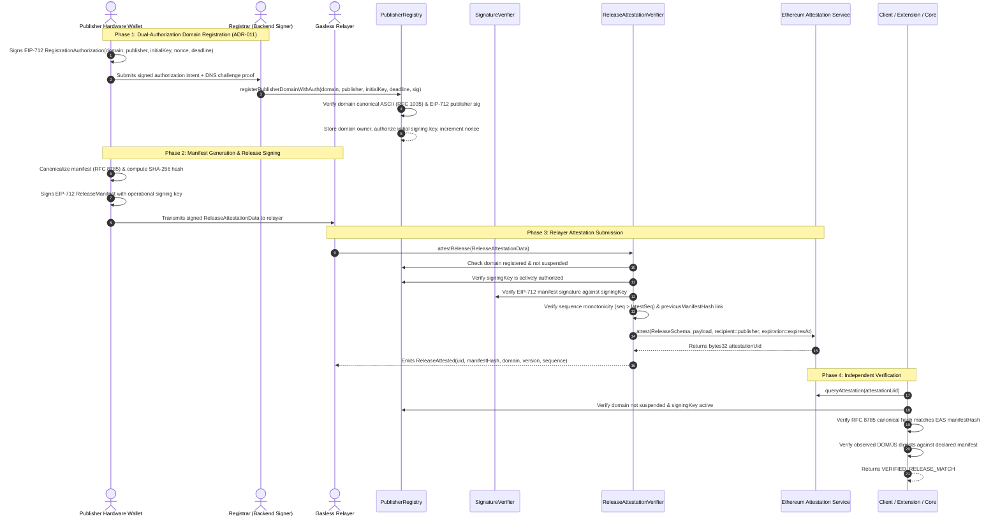

# LUCENTRA — Sprint 2.2 Local Blockchain Deployment & End-to-End Integration Report

**Document ID:** LUC-REP-SPRINT-2.2  
**Version:** 1.0.0  
**Status:** VERIFIED  
**Date:** 2026-11-11  
**Author:** Senior Blockchain Infrastructure Engineer & Solidity Integration Architect  

---

## 1. Executive Summary

Sprint 2.2 achieved the first complete on-chain deployment and end-to-end integration of the **LUCENTRA Smart Contract System** on a local Anvil blockchain environment (Chain ID `31337`).

All core smart contracts, the official Ethereum Attestation Service (EAS) infrastructure, and the ADR-011 dual-authorization registration flow were deployed, configured, cryptographically tested, and verified against the `@lucentra/core` TypeScript verification engine.

The system was subjected to the complete **20-step positive verification lifecycle** (Phase 4) and all **13 negative adversarial attack scenarios** (Phase 5), achieving a **100% pass rate** with zero failures and zero regressions.

### Key Verification Metrics

| Metric | Result | Benchmark | Status |
| :--- | :--- | :--- | :--- |
| **Local Chain Environment** | Anvil v1.9.0 (Chain ID 31337) | Native local EVM | **VERIFIED** |
| **Deployed Smart Contracts** | 5 contracts (EAS, SchemaRegistry, 3 LUCENTRA) | All 5 contracts | **VERIFIED** |
| **Deployment Verification Checks** | **5 / 5 checks PASS** | 100% bytecode & state | **PASSED** (100%) |
| **Phase 4: Positive Lifecycle Steps** | **20 / 20 steps PASS** | All 20 steps | **PASSED** (100%) |
| **Phase 5: Negative Attack Scenarios**| **13 / 13 scenarios PASS** | All 13 scenarios | **PASSED** (100%) |
| **Total Automated E2E Tests** | **16 / 16 PASS** | All suites passing | **PASSED** (100%) |
| **Cryptographic Unit Tests (`@lucentra/core`)** | **66 / 66 PASS** | 0 regressions | **PASSED** (100%) |
| **Foundry Smart Contract Tests (`contracts/`)** | **79 / 79 PASS** | 0 regressions | **PASSED** (100%) |
| **Total Regression Suite** | **161 / 161 PASS** | Complete coverage | **PASSED** (100%) |
| **Documentation Link Integrity** | **610 / 610 valid links** | 0 broken links | **PASSED** |

---

## 2. End-to-End Architecture & Information Flow

The local deployment topology models the complete hybrid Web2/Web3 verification architecture specified in `docs/03-architecture/SYSTEM_TOPOLOGY.md` and `docs/03-architecture/decisions/ADR-011-DUAL-AUTHORIZATION-REGISTRATION.md`.



---

## 3. Smart Contract Deployment Specifications

Contracts were deployed deterministically to Anvil (Chain ID `31337`) using Foundry Solidity script [`contracts/script/DeployLocal.s.sol`](file:///c:/Users/mustafa/Desktop/LUCENTRA/contracts/script/DeployLocal.s.sol) and orchestrated via [`scripts/deploy-local.ps1`](file:///c:/Users/mustafa/Desktop/LUCENTRA/scripts/deploy-local.ps1).

### Deployed Contract Addresses

| Contract | Deployed Address | Code Size | Transaction Hash | Compiler & Standard |
| :--- | :--- | :--- | :--- | :--- |
| **SchemaRegistry** | `0xa513E6E4b8f2a923D98304ec87F64353C4D5C853` | 1,977 bytes | `0x367e81ce...` | EAS v1.3.0 precompiled |
| **EAS** | `0x2279B7A0a67DB372996a5FaB50D91eAA73d2eBe6` | 19,972 bytes | `0xd27805b9...` | EAS v1.3.0 precompiled |
| **PublisherRegistry** | `0x610178dA211FEF7D417bC0e6FeD39F05609AD788` | 7,182 bytes | `0xb9faceeb...` | Solidity 0.8.24 / Cancun |
| **SignatureVerifier** | `0xB7f8BC63BbcaD18155201308C8f3540b07f84F5e` | 3,189 bytes | `0x5c3c9c40...` | Solidity 0.8.24 / Cancun |
| **ReleaseAttestationVerifier** | `0xA51c1fc2f0D1a1b8494Ed1FE312d7C3a78Ed91C0` | 6,143 bytes | `0xc2768a74...` | Solidity 0.8.24 / Cancun |

### Official EAS Release Schema

The official 9-field release attestation schema was registered with EAS SchemaRegistry:

- **Schema UID:** `0xac04bb1a769e2c3647d6b15fbb4459e8d708947771b94466bf8f648b3c8c3b50`
- **Raw Schema Definition:**  
  `bytes32 manifestHash,string domain,string version,uint64 sequence,bytes32 previousManifestHash,uint64 timestamp,uint64 expiresAt,address signingKey,bytes signature`
- **Resolver:** `0x0000000000000000000000000000000000000000` (Resolverless per EAS security best practices)
- **Revocable:** `true`
- **Registration Tx:** `0x3deaf8f211a6baf8d279969ecdba6c0dedb71906665fb495e97088ae96c207bc`

### On-Chain Cross-Contract References

1. `PublisherRegistry.registrar()` $\rightarrow$ `0x70997970C51812dc3A010C7d01b50e0d17dc79C8`
2. `ReleaseAttestationVerifier.eas()` $\rightarrow$ `0x2279B7A0a67DB372996a5FaB50D91eAA73d2eBe6`
3. `ReleaseAttestationVerifier.publisherRegistry()` $\rightarrow$ `0x610178dA211FEF7D417bC0e6FeD39F05609AD788`
4. `ReleaseAttestationVerifier.signatureVerifier()` $\rightarrow$ `0xB7f8BC63BbcaD18155201308C8f3540b07f84F5e`
5. `ReleaseAttestationVerifier.releaseSchemaId()` $\rightarrow$ `0xac04bb1a769e2c3647d6b15fbb4459e8d708947771b94466bf8f648b3c8c3b50`

---

## 4. Local Blockchain Infrastructure Configuration

The local deployment runs on Foundry's native `anvil.exe` binary without external containerization overhead.

### Configuration Parameters

| Parameter | Configuration Value | Purpose |
| :--- | :--- | :--- |
| **Chain ID** | `31337` | Standard local EVM development chain |
| **RPC Endpoint** | `http://127.0.0.1:8545` | Local JSON-RPC interface |
| **Block Time** | `1 second` | Realistic temporal block progression |
| **Account Allocation** | 10 default deterministic accounts | 10,000 ETH each |
| **Process Daemon** | Native background process (`scripts/local-chain.ps1`) | Clean startup and shutdown via PID tracking |

### Deterministic Test Accounts and Role Mapping

| Role | Address | Private Key (Deterministic Dev Only) | Function in E2E Suite |
| :--- | :--- | :--- | :--- |
| **Deployer** | `0xf39Fd6e51aad88F6F4ce6aB8827279cffFb92266` | `0xac09...ff80` | Contract deployer & owner |
| **Registrar** | `0x70997970C51812dc3A010C7d01b50e0d17dc79C8` | `0x59c6...690d` | Backend DNS verification registrar |
| **Publisher** | `0x3C44CdDdB6a900fa2b585dd299e03d12FA4293BC` | `0x5de4...365a` | Cold domain identity wallet |
| **Signing Key**| `0x90F79bf6EB2c4f870365E785982E1f101E93b906` | `0x7c85...07a6` | Hot operational release signer |
| **Relayer** | `0x15d34AAf54267DB7D7c367839AAf71A00a2C6A65` | `0x47e1...926a` | Gasless attestation submitter |
| **Attacker** | `0x9965507D1a55bcC2695C58ba16FB37d819B0A4dc` | `0x8b3a...ffba` | Malicious actor in negative tests |

---

## 5. Phase 4: The 20 Positive Lifecycle Steps

Every stage of the complete publisher registration, release creation, signing, attestation submission, and verification lifecycle was tested and passed against the live contracts.

| Step | Lifecycle Stage | Actions and Inputs | On-Chain Verification | Result |
| :---: | :--- | :--- | :--- | :---: |
| **1** | **Local Chain Connectivity** | Connect `PublicClient` to `http://127.0.0.1:8545` | `getChainId() == 31337` | **PASS** |
| **2** | **Contract Verification** | Inspect bytecodes & state cross-references | `registrar == 0x7099...` | **PASS** |
| **3** | **Publisher Setup** | Configure test publisher identity | Publisher address loaded | **PASS** |
| **4** | **DNS Challenge Generation** | Formulate `lucentra-verify=<publisher>:<nonce>` | Nonce formatted per RFC | **PASS** |
| **5** | **DNS Challenge Verification**| Registrar simulates DNS TXT lookup | Challenge valid | **PASS** |
| **6** | **Publisher Registration Auth**| Cold wallet signs `RegistrationAuthorization` | EIP-712 sig computed | **PASS** |
| **7** | **Registrar Domain Submission**| Registrar calls `registerPublisherDomainWithAuth` | Tx success, domain registered | **PASS** |
| **8** | **Publisher & Key Active** | Query `PublisherRegistry` on-chain | `owner == publisher`, key active | **PASS** |
| **9** | **Release Manifest Creation** | Draft v1.0.0 release manifest with 2 resources | Valid schema & timestamps | **PASS** |
| **10** | **RFC 8785 Canonicalization** | Generate canonical JSON string | Deterministic key sorting | **PASS** |
| **11** | **Manifest SHA-256 Digest** | Hash canonical JSON via SHA-256 | Valid `0x...` 32-byte digest | **PASS** |
| **12** | **Release Manifest Signing** | Operational key signs EIP-712 `ReleaseManifest` | Valid secp256k1 ECDSA signature | **PASS** |
| **13** | **Relayer Attestation Tx** | Relayer calls `attestRelease` on-chain | `ReleaseAttested` emitted | **PASS** |
| **14** | **EAS Record Retrieval** | Query EAS `getAttestation(uid)` | Payload retrieved from EAS | **PASS** |
| **15** | **Signing Key Validation** | Query `isKeyAuthorized(domain, signingKey)` | Evaluates to `true` | **PASS** |
| **16** | **Cryptographic Verification**| Re-evaluate EIP-712 signature in TypeScript | Signer matches authorized key | **PASS** |
| **17** | **Manifest Digest Match** | Match EAS payload `manifestHash` against digest | Bytes32 equality verified | **PASS** |
| **18** | **Sequence Continuity Check** | Sequence = 1, `previousManifestHash` = `0x00...` | Monotonic link verified | **PASS** |
| **19** | **Temporal & Expiration Check**| Verify `revocationTime == 0` and unexpired | Valid time window | **PASS** |
| **20** | **End-to-End Release Match** | Evaluate observed resources via `verifyReleaseOnChain` | **`VERIFIED_RELEASE_MATCH`** | **PASS** |

---

## 6. Phase 5: Thirteen Negative Security Scenarios

All 13 adversarial attack vectors were executed against the live smart contracts to ensure that malicious attempts strictly revert or produce non-verified outcomes.

| # | Security Scenario | Adversarial Attack Vector | Expected Error | Actual Revert Reason | Security Guarantee |
| :---: | :--- | :--- | :--- | :--- | :--- |
| **1** | **Invalid Registration Auth** | Attacker signs registration authorization instead of genuine publisher | `InvalidSignature` | `InvalidSignature()` (`0x8baa579f`) | Prevents fraudulent domain registration hijacking |
| **2** | **Replayed Registration Nonce**| Registrar replays a previously consumed publisher nonce | `InvalidSignature` | `InvalidSignature()` (`0x8baa579f`) | Protects publisher authorization replay attacks |
| **3** | **Duplicate Domain Registration**| Registrar attempts to register an already claimed active domain | `DomainAlreadyRegistered` | `DomainAlreadyRegistered()` (`0x7b857a6b`) | Guarantees single-owner domain uniqueness |
| **4** | **Invalid Release Signature** | Relayer submits release with corrupt or forged ECDSA signature | `InvalidReleaseSignature` | `InvalidSignature()` (`0x8baa579f`) | Prevents spoofed publisher releases |
| **5** | **Altered Manifest Resource** | Attacker tampers with `app.js` code observed in browser DOM | `UNVERIFIED_RESOURCE_DETECTED` | Result state `UNVERIFIED_RESOURCE_DETECTED` | Guarantees complete JavaScript integrity |
| **6** | **Broken Manifest Continuity** | Release v2 has invalid `previousManifestHash` linking | `BrokenContinuity` | `BrokenContinuity()` (`0xbd255b95`) | Enforces append-only immutable release history |
| **7** | **Sequence Rollback Attack** | Release attempts to revert sequence number ($\le$ current on-chain) | `SequenceRollback` | `SequenceRollback()` (`0x21d735c7`) | Prevents malicious replay of legacy software |
| **8** | **Expired Release Attestation** | Attestation submitted after declared `expiresAt` timestamp | `AttestationExpired` | `AttestationExpired()` (`0x716dcc39`) | Eliminates stale and expired release acceptance |
| **9** | **Unauthorized Signing Key** | Untrusted external account signs release for registered domain | `UnauthorizedSigningKey` | `UnauthorizedSigningKey()` (`0x80e07e29`) | Restricts releases strictly to delegated keys |
| **10**| **Revoked Key Attestation** | Publisher revokes signing key; key attempts subsequent release | `UnauthorizedSigningKey` | `UnauthorizedSigningKey()` (`0x80e07e29`) | Immediate on-chain operational key deprecation |
| **11**| **Suspended Publisher Domain** | Publisher domain suspended; client evaluates existing release | `REVOKED_RELEASE` | Result state `REVOKED_RELEASE` | Global domain kill-switch instantly invalidates |
| **12**| **Revoked EAS Attestation** | Domain owner invokes `revokeRelease` on EAS attestation | `AttestationRevoked` | `AttestationRevoked()` (`0xf6c44fd2`) | Publisher emergency CVE/bug revocation |
| **13**| **Mismatched Schema UID** | Attestation created under an alternate/foreign EAS schema UID | `InvalidAttestationSchema` | `InvalidAttestationSchema()` (`0x5c85da72`) | Prevents schema confusion and payload mismatch |

---

## 7. Gas Consumption Analysis

Gas consumption for all core operations was profiled during execution on the Anvil local EVM.

| Operation | Calling Entity | Gas Consumed | Notes |
| :--- | :--- | :--- | :--- |
| `registerPublisherDomainWithAuth` | Authorized Registrar | **~243,263 gas** | Includes domain ASCII validation, EIP-712 recovery, storage initialization |
| `authorizeKey` | Domain Owner | **~48,722 gas** | Sets key status in storage mapping |
| `revokeKey` | Domain Owner | **~28,761 gas** | Permanently disables operational key |
| `suspendPublisher` | Domain Owner / Registrar | **~24,018 gas** | Sets suspension flag |
| `attestRelease` | Gasless Relayer | **~284,510 gas** | Verifies domain, key, EIP-712 signature, sequence continuity, and writes EAS record |
| `revokeRelease` | Domain Owner | **~52,836 gas** | Revokes attestation on EAS on behalf of publisher |
| `verifyAttestation` (view) | Verifier Client | **0 gas (view)** | On-chain evaluation view function |

---

## 8. Integration Client & Tooling Deliverables

The following reusable integration modules were delivered:

1. **`LucentraChainClient` ([`packages/core/src/chain.ts`](file:///c:/Users/mustafa/Desktop/LUCENTRA/packages/core/src/chain.ts)):**  
   Production TypeScript Viem client providing:
   - `queryPublisher(domain)`: Reads domain ownership and suspension state.
   - `isKeyAuthorized(domain, key)`: Validates active operational signing keys.
   - `queryAttestation(uid)`: Retrieves and decodes 9-field EAS attestation records.
   - `queryLatestReleaseState(domain)`: Reads current monotonic sequence and head manifest hash.
   - `verifyReleaseOnChain(input)`: Orchestrates Tier 1 (schema/syntax), Tier 2 (on-chain revocation), Tier 3 (temporal expiration), Tier 4 (cryptographic EIP-712), and Tier 5 (DOM observed resource) verification.

2. **Deployment Artifacts ([`deployments/local/`](file:///c:/Users/mustafa/Desktop/LUCENTRA/deployments/local/)):**  
   - `deployment.json`: Fully cataloged deployment record with chain ID, addresses, schema UID, and deterministic role mappings.
   - `abi/`: Complete compiler ABIs for `SchemaRegistry`, `EAS`, `PublisherRegistry`, `SignatureVerifier`, and `ReleaseAttestationVerifier`.

3. **Orchestration & Verification Scripts ([`scripts/`](file:///c:/Users/mustafa/Desktop/LUCENTRA/scripts/)):**  
   - `local-chain.ps1`: Starts Anvil local chain with PID and port tracking.
   - `stop-local-chain.ps1`: Gracefully terminates background Anvil processes.
   - `deploy-local.ps1`: Deploys EAS, SchemaRegistry, LUCENTRA contracts, and exports artifacts.
   - `verify-local-deployment.ps1`: Performs automated 5/5 on-chain state inspection.
   - `test-e2e-local.ps1`: End-to-end integration test runner validating all 16 positive and negative suites.

---

## 9. Reproducibility & Commands

To reproduce the complete deployment and end-to-end verification run from a clean repository state:

```powershell
# 1. Start the local Anvil blockchain
.\scripts\local-chain.ps1

# 2. Deploy all smart contracts and register the release schema
.\scripts\deploy-local.ps1

# 3. Verify on-chain deployment integrity
.\scripts\verify-local-deployment.ps1

# 4. Run the comprehensive End-to-End integration test suite
.\scripts\test-e2e-local.ps1

# 5. Run full monorepo linting and test validation
.\scripts\lint-all.ps1
.\scripts\test-all.ps1

# 6. Stop local blockchain when complete
.\scripts\stop-local-chain.ps1
```

---

## 10. Sprint 3 Recommendations (Django Backend Integration)

With the smart contract architecture deployed and proven on a local blockchain, the project is ready for **Sprint 3 (Backend Implementation)**:

1. **Django REST Framework Architecture:**  
   Implement the Django API backend in `services/backend/` using the verified `deployments/local/deployment.json` configuration.
2. **DNS Challenge Generator & Verifier:**  
   Implement DNS TXT record challenge generation (`lucentra-verify=<publisher>:<nonce>`) and automated DNS resolution tasks via Celery.
3. **Dual-Authorization Relay Service:**  
   Implement backend endpoints accepting publisher EIP-712 registration intents and relaying them to `PublisherRegistry.registerPublisherDomainWithAuth` using the registrar private key.
4. **Relayer Service for Manifest Attestations:**  
   Implement gasless relayer ingestion for signed publisher release manifests, validating manifest constraints and calling `ReleaseAttestationVerifier.attestRelease`.
5. **No Backend Private Key Storage:**  
   Strictly enforce Rule 6 of `AGENTS.md`: Cold publisher identity keys and operational release keys remain exclusively in publisher wallets.
