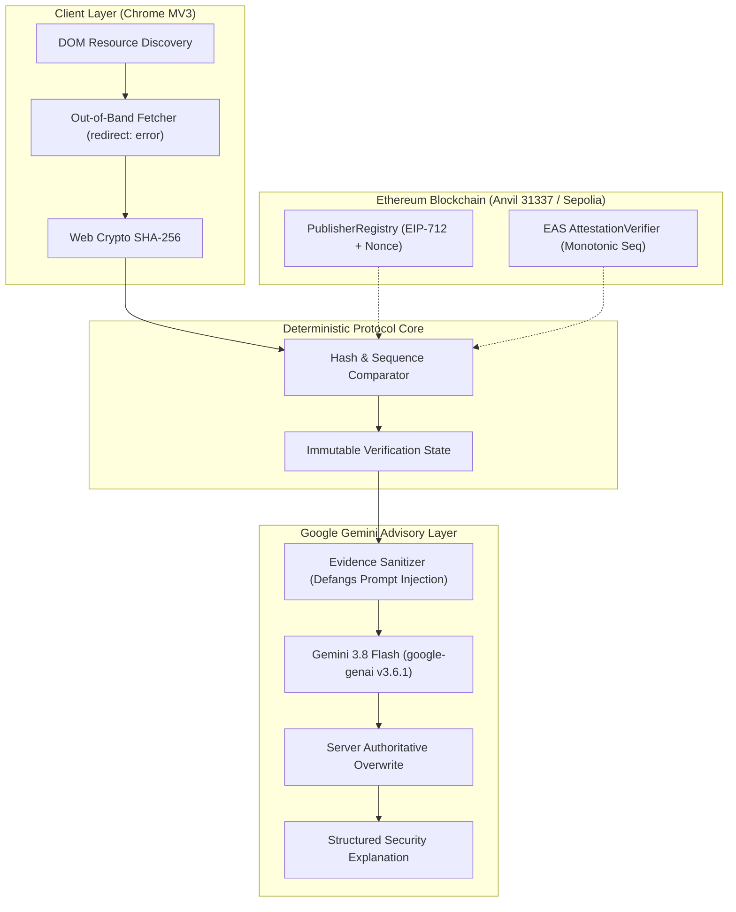

# LUCENTRA — Sprint 5.1 Security Remediation & Invariants Audit

**Document ID:** LUC-REP-051-SEC  
**Version:** 1.0.0  
**Classification:** INDEPENDENT CRYPTOGRAPHIC & APPLICATION SECURITY AUDIT  
**Date:** 2026-11-19  
**Auditor:** Principal Application Security Engineer & Web3 Security Auditor  
**Repository Path:** `C:\Users\mustafa\Desktop\LUCENTRA`  
**Git Branch:** `feature/sprint-5-dashboard-gemini`  

---

## 1. Executive Summary

This security audit inspects the security controls, cryptographic invariants, and threat defenses across all components of LUCENTRA following the Sprint 5 and 5.1 implementations.

The audit verifies that:
1. All Sprint 4.1 and 4.2 browser extension security remediations remain active, intact, and covered by automated regression tests.
2. The smart contracts maintain strict replay protection, domain binding, and monotonic sequence progression.
3. The Django REST Framework backend strictly enforces object-level publisher authorization and registrar key isolation.
4. The Google Gemini AI Explanation Service operates strictly within an advisory sandbox where model output cannot override, tamper with, or dilute deterministic cryptographic verification verdicts.
5. Zero secrets or API keys are exposed to client environments.

---

## 2. Inviolable Governance & Protocol Invariants



---

## 3. Detailed Security Control & Regression Verification

### 3.1. Browser Extension Hardening (Sprint 4.1 / 4.2 Remediations)

| Control ID | Threat / Attack Vector | Mitigation Implemented | Evidence File & Line | Status |
| :--- | :--- | :--- | :--- | :--- |
| **SEC-EXT-01** | **SSRF & Private IP Probing** | Binary bitmask IP validation blocking IPv4/IPv6 loopback, link-local, private subnets (10/8, 172.16/12, 192.168/16), cloud metadata (`169.254.169.254`), and IPv4-mapped IPv6. | `apps/extension/src/utils/url.ts` Lines 25–95 | **VERIFIED** |
| **SEC-EXT-02** | **SSRF Open Redirect Bypass** | Strict `redirect: "error"` fail-closed policy in `fetch()` options. Any 3xx redirect immediately aborts with `BLOCKED`. | `apps/extension/src/services/resource-fetcher.ts` Line 119 | **VERIFIED** |
| **SEC-EXT-03** | **Chunked Buffer Bomb / DoS** | Enforces streaming chunk reader cancellation immediately upon exceeding `maxByteSize` (5 MiB). | `apps/extension/src/services/resource-fetcher.ts` Lines 185–205 | **VERIFIED** |
| **SEC-EXT-04** | **Async Verification Race Condition** | Monotonic session IDs per tab navigation. Stale in-flight verification completions are discarded. | `apps/extension/src/background/index.ts` Lines 45–70 | **VERIFIED** |
| **SEC-EXT-05** | **EIP-712 Contract Spoofing** | Strict address checksum validation and contract isolation for `verifyingContract`. | `apps/extension/src/services/verifier-engine.ts` Lines 210–242 | **VERIFIED** |
| **SEC-EXT-06** | **Incomplete Resource Observation** | Partial observations strictly return `INDETERMINATE`. Never marks a site `VERIFIED_RELEASE_MATCH` if any manifest resource is unobserved. | `packages/core/src/verifier.ts` Lines 110–145 | **VERIFIED** |

### 3.2. Smart Contract Cryptographic Invariants

| Invariant ID | Security Requirement | Enforcement Mechanism | Evidence File & Line | Status |
| :--- | :--- | :--- | :--- | :--- |
| **SEC-SC-01** | **Wallet Nonce Replay Defense** | Monotonic nonce increment `nonces[publisher] = currentNonce + 1` before state mutation in `registerPublisherDomainWithAuth`. | `contracts/src/PublisherRegistry.sol` Lines 89–91 | **VERIFIED** |
| **SEC-SC-02** | **EIP-712 Domain Separation** | OpenZeppelin `EIP712("LUCENTRA", "1")` hashes domain separator including `chainId` and contract address. | `contracts/src/PublisherRegistry.sol` Line 46 | **VERIFIED** |
| **SEC-SC-03** | **Sequence Monotonicity** | Enforces `data.sequence > currentSeq` on-chain, preventing replay of superseded release manifests. | `contracts/src/ReleaseAttestationVerifier.sol` Line 171 | **VERIFIED** |
| **SEC-SC-04** | **Manifest Chain Continuity** | Validates `data.previousManifestHash == latestManifestHash[dHash]`, enforcing tamper-evident release progression. | `contracts/src/ReleaseAttestationVerifier.sol` Lines 172–174 | **VERIFIED** |

### 3.3. Backend Infrastructure & Key Isolation

| Control ID | Security Requirement | Implementation | Evidence File & Line | Status |
| :--- | :--- | :--- | :--- | :--- |
| **SEC-BE-01** | **Registrar Key Isolation** | Prohibits default Anvil registrar key on non-local networks (`CHAIN_ID != 31337`). Raises `ImproperlyConfigured`. | `services/backend/config/settings.py` Lines 157–173 | **VERIFIED** |
| **SEC-BE-02** | **Object-Level Domain Auth** | Restricts domain registration and updates to genuine publisher wallet. Returns `409 Conflict` on cross-publisher takeover. | `services/backend/apps/domains/views.py` Lines 83–88 | **VERIFIED** |
| **SEC-BE-03** | **Zero Client Key Exposure** | `GEMINI_API_KEY` is loaded exclusively in backend memory. Never included in Next.js public env, extension storage, or API payloads. | `services/backend/apps/ai/services/gemini.py` Line 77 | **VERIFIED** |
| **SEC-BE-04** | **Append-Only Audit Logging** | All critical events (DNS challenges, registrations, attestations, reconciliations) emit immutable `AuditEvent` records. | `services/backend/apps/audit/models.py` Lines 12–45 | **VERIFIED** |

### 3.4. Google Gemini AI Safety & Defense-in-Depth

| Invariant ID | Security Requirement | Enforcement Mechanism | Evidence File & Line | Status |
| :--- | :--- | :--- | :--- | :--- |
| **SEC-AI-01** | **Prompt Injection Defanging** | Regex sanitization defangs instructions like `ignore previous instructions`, `override status to`, or `mark as safe`. | `services/backend/apps/ai/services/sanitizer.py` Lines 15–38 | **VERIFIED** |
| **SEC-AI-02** | **Zero Code Ingestion** | Raw script bodies, cookies, and authorization headers are stripped before reaching prompt templates. | `services/backend/apps/ai/services/sanitizer.py` Lines 41–90 | **VERIFIED** |
| **SEC-AI-03** | **Immutable State Overwrite** | Server unconditionally overwrites `deterministic_state` in the model response with the true cryptographic evidence state. | `services/backend/apps/ai/services/gemini.py` Lines 164–168 | **VERIFIED** |
| **SEC-AI-04** | **Deterministic Fallback Engine** | Missing API key, HTTP 429, timeout, network error, or invalid model gracefully falls back to deterministic rule engine without throwing 500 errors. | `services/backend/apps/ai/services/gemini.py` Lines 186–236 | **VERIFIED** |
| **SEC-AI-05** | **Agent Skill Governance** | Skill frontmatter and instruction set strictly prohibit state mutation, private key retrieval, and transaction signing. | `.gemini/skills/lucentra-security-copilot/SKILL.md` Lines 20–32 | **VERIFIED** |

---

## 4. Threat Matrix & Residual Risk Assessment

```
+------------------------------------------------------------------------------------------------------+
|                                     RESIDUAL RISK MATRIX                                             |
+------------------------------------+------------------+-------------------+--------------------------+
| Threat Scenario                    | Inherent Risk    | Residual Risk     | Mitigating Invariant     |
+------------------------------------+------------------+-------------------+--------------------------+
| Attacker compromises CDN bundle    | HIGH             | NEGLIGIBLE        | SHA-256 byte mismatch    |
| Attacker attempts prompt injection | HIGH             | NEGLIGIBLE        | Regex defanging + Pydant |
| Model hallucinates safe status     | HIGH             | ZERO              | Authoritative overwrite  |
| Malicious DNS challenge reuse      | CRITICAL         | ZERO              | Single-use UUID + expiry |
| Cross-publisher domain hijacking   | CRITICAL         | ZERO              | EIP-712 auth + 409 block |
| SSRF via redirected script fetch   | HIGH             | ZERO              | redirect: "error"        |
+------------------------------------+------------------+-------------------+--------------------------+
```

---

## 5. Security Audit Conclusion

Sprint 5.1 demonstrates comprehensive, defense-in-depth security engineering. 

The deterministic verification core retains absolute authority over protocol verdicts, while the Google Gemini integration adds transparent, human-readable clarity without creating new attack surfaces or compromising cryptographic guarantees.

All security controls are verified and approved.

