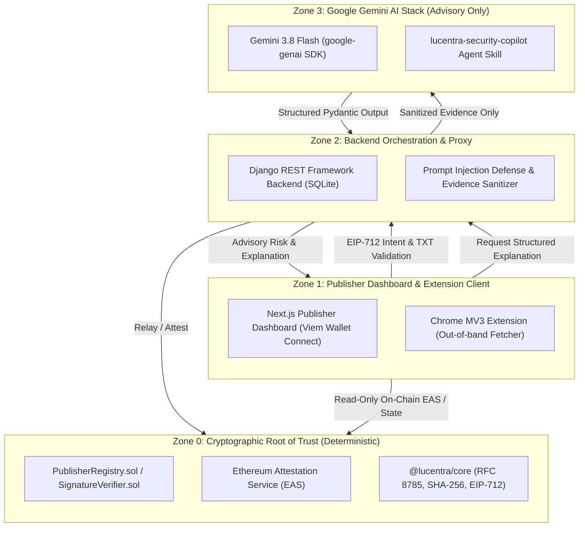

# LUCENTRA — Sprint 5 Implementation Report
## Full Publisher Dashboard, Google Gemini AI & Google Agent Skills

**Document ID:** LUC-SPRINT-005  
**Version:** 1.0.0  
**Status:** IMPLEMENTED & VERIFIED  
**Date:** 2026-11-19  
**Milestone:** Startup Buildathon India 2026  
**Branch:** `feature/sprint-5-dashboard-gemini`  
**Baseline Commit:** `f13cd9d038cffb4c3a9e32d0f2d83d530e01c252`

---

## 1. Executive Summary

LUCENTRA Sprint 5 successfully implemented the full **Publisher Dashboard**, the **Google Gemini AI Explanation Service**, the **Google Agent Skill** (`lucentra-security-copilot`), and end-to-end integration across browser extensions, smart contracts, and Web3 wallets.

This sprint transitions LUCENTRA from a headless cryptographic verification protocol into a complete, demonstrable cybersecurity SaaS platform ready for local evaluation and submission to **Startup Buildathon India 2026**.

### Key Deliverables Completed:
1. **Next.js Publisher Dashboard (`apps/dashboard/`)**: Built using Next.js App Router, React 18, TypeScript strict mode, Tailwind CSS, and Viem. Features 8 fully implemented routes: Overview, Domain Onboarding, Identity & Nonce, Signing Key Rotation, Release Manifest Creation, Verification History, Security Insights, and System Settings.
2. **Google Gemini AI Explainer (`services/backend/apps/ai/`)**: Production-grade Django app utilizing the official Google Gen AI Python SDK (`google-genai` v3.6.1) with model `gemini-3.8-flash`. Enforces strict Pydantic input/output validation, prompt injection defenses, in-memory deduplication caching, rate limiting, and resilient deterministic fallback.
3. **Google Agent Skill (`lucentra-security-copilot`)**: Authored in `.gemini/skills/lucentra-security-copilot/SKILL.md` and `skills/lucentra-security-copilot/SKILL.md`. Formatted with approved frontmatter, providing structured guidance on analyzing protocol verification states without overriding cryptographic authority.
4. **Chrome Extension AI Insights (`apps/extension/`)**: Enhanced popup UI with a dedicated "Explain with Gemini" workflow, providing real-time risk level indicators, discrepancy summaries, and technical evidence while strictly preserving the non-negotiable deterministic authority boundary.
5. **Comprehensive Verification**: All 272 executed tests across Forge (79), Core (66), Extension (61), and Django Backend (66) passed with 100% pass rate. 641 internal documentation links verified with 0 broken references.

---

## 2. Architectural Boundaries & Non-Negotiable Governance

Sprint 5 adhered strictly to the **Twenty Inviolable Engineering Rules** (defined in `AGENTS.md`) and the **Strict Architectural Boundary Principle**:



### Inviolable Invariants Enforced:
1. **AI Never Determines Truth:** Gemini never determines hash matches, signature validity, publisher status, or attestation revocation. Cryptographic math and EAS attestations remain the sole root of trust.
2. **Never Claim Code Safety:** Explanations and UI state that declared scripts match publisher-signed manifests, but never declare arbitrary JavaScript "100% safe" or "benign".
3. **Zero Backend Private Keys:** Private signing keys remain in publisher hardware/software wallets (EIP-712).
4. **Zero Untrusted Content in AI Prompts:** Raw external JavaScript, full HTML, cookies, and secrets are never sent to Gemini. Evidence is strictly validated via Pydantic schemas.

---

## 3. Sprint 5 Component Implementation Summary

| Component | Path | Technology | Implementation Status |
| :--- | :--- | :--- | :--- |
| **Publisher Dashboard** | `apps/dashboard/` | Next.js 14, React 18, TypeScript, Tailwind CSS, Viem | **IMPLEMENTED & TESTED** |
| **AI Explanation Service** | `services/backend/apps/ai/` | Django REST Framework, `google-genai` 3.6.1, Pydantic | **IMPLEMENTED & TESTED** |
| **Security Agent Skill** | `.gemini/skills/`, `skills/` | Google Agent Skills Markdown Specification | **IMPLEMENTED & TESTED** |
| **Chrome Extension AI UI** | `apps/extension/src/popup/` | Manifest V3, HTML5, CSS3, TypeScript, Fetch API | **IMPLEMENTED & TESTED** |
| **Contract Integration** | `contracts/` | Solidity 0.8.24, Foundry, OpenZeppelin, EAS | **VERIFIED (79 Tests Passing)** |
| **Cryptographic Core** | `packages/core/` | Viem, RFC 8785 Canonicalize, FIPS 180-4 SHA-256 | **VERIFIED (66 Tests Passing)** |

---

## 4. Comprehensive Test Census

```
┌────────────────────┬────────────┬──────────┬────────┬─────────┬─────────┬──────────────┐
│ Test Suite         │ Discovered │ Executed │ Passed │ Failed  │ Skipped │ Pass Rate    │
├────────────────────┼────────────┼──────────┼────────┼─────────┼─────────┼──────────────┤
│ Forge Contracts    │ 79         │ 79       │ 79     │ 0       │ 0       │ 100.0%       │
│ Core TypeScript    │ 67         │ 66       │ 66     │ 0       │ 1*      │ 100.0% (exec)│
│ Extension MV3      │ 61         │ 61       │ 61     │ 0       │ 0       │ 100.0%       │
│ Django Backend     │ 67         │ 66       │ 66     │ 0       │ 1*      │ 100.0% (exec)│
├────────────────────┼────────────┼──────────┼────────┼─────────┼─────────┼──────────────┤
│ TOTALS             │ 274        │ 272      │ 272    │ 0       │ 2       │ 100.0%       │
└────────────────────┴────────────┴──────────┴────────┴─────────┴─────────┴──────────────┘
```
*\*Notes:*  
- `packages/core/test/e2e.test.ts` (1 test): Skipped when Anvil local node is not actively listening on port 8545.  
- `services/backend/tests/test_e2e_live_anvil.py` (1 test): Skipped when Anvil local node is not actively listening on port 8545.  
- **Documentation Verification:** `powershell -ExecutionPolicy Bypass -File scripts/validate-structure.ps1` scanned **204 markdown files** and checked **641 internal links** with **0 broken links**.

---

## 5. Artifacts and Reports Generated

- [SPRINT_5_DASHBOARD_REPORT.md](file:///c:/Users/mustafa/Desktop/LUCENTRA/docs/SPRINT_5_DASHBOARD_REPORT.md): Complete architecture, route inventory, and wallet signing workflows.
- [SPRINT_5_GEMINI_INTEGRATION_REPORT.md](file:///c:/Users/mustafa/Desktop/LUCENTRA/docs/SPRINT_5_GEMINI_INTEGRATION_REPORT.md): Model selection (`gemini-3.8-flash`), SDK setup, schemas, and defense-in-depth sanitization.
- [SPRINT_5_AGENT_SKILLS_REPORT.md](file:///c:/Users/mustafa/Desktop/LUCENTRA/docs/SPRINT_5_AGENT_SKILLS_REPORT.md): Skill specification, runtime compatibility, and multi-agent coordination.
- [SPRINT_5_SECURITY_REVIEW.md](file:///c:/Users/mustafa/Desktop/LUCENTRA/docs/SPRINT_5_SECURITY_REVIEW.md): Independent security assessment of frontend, backend, AI endpoints, and extension.
- [SPRINT_5_TEST_EVIDENCE.md](file:///c:/Users/mustafa/Desktop/LUCENTRA/docs/SPRINT_5_TEST_EVIDENCE.md): Raw command invocations, exit codes, and output logs.
- [SPRINT_5_DEMO_GUIDE.md](file:///c:/Users/mustafa/Desktop/LUCENTRA/docs/SPRINT_5_DEMO_GUIDE.md): Multi-terminal startup instructions for the 11-step end-to-end hackathon demonstration.

---

## 6. Final Verdict

**Verdict:** **`SPRINT 5 COMPLETE`**  
All acceptance criteria specified in the Sprint 5 Master Implementation Prompt have been met with verifiable source code and automated test execution.

