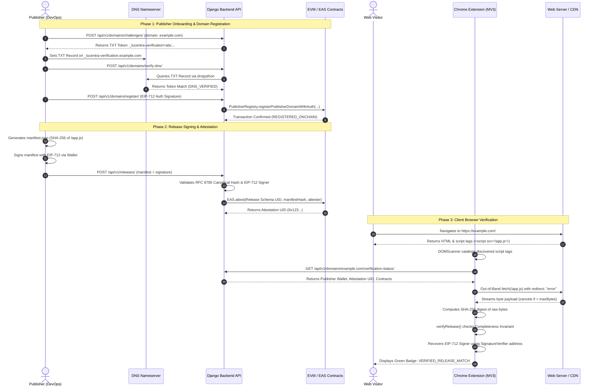

# LUCENTRA — Architecture Status & Component Implementation Audit

**Document ID:** LUC-AUD-002  
**Version:** 1.0.0  
**Classification:** TECHNICAL ARCHITECTURE AUDIT  
**Audit Date:** 2026-11-19  
**Auditor:** Principal Software Architect & Web3 Systems Engineer  
**Repository Path:** `C:\Users\mustafa\Desktop\LUCENTRA`  
**Git Branch:** `security/sprint-4-2-hardening`  
**HEAD Commit Audited:** [`f13cd9d`](file:///c:/Users/mustafa/Desktop/LUCENTRA)  

---

## 1. Architectural Architecture Overview

LUCENTRA operates as a hybrid Web2/Web3 internet verification architecture designed to verify website publisher identity and JavaScript resource integrity through cryptographic evidence.

```
       +-------------------------------------------------------------+
       |                        ZONE 0: UNTRUSTED                     |
       |  Public Internet, Target Web Origins, Third-Party CDNs      |
       +------------------------------+------------------------------+
                                      |
                     [DOM Script Tags & Asset URLs]
                                      |
                                      v
+----------------------------------------------------------------------------+
|                    ZONE 1: CLIENT SANDBOX / BROWSER RUNTIME                 |
|                                                                            |
|   +--------------------------------------------------------------------+   |
|   | apps/extension/src/content/ (IIFE Content Script)                  |   |
|   | - DOM Inspection, MutationObserver, Script Tag Extraction          |   |
|   +---------------------------------+----------------------------------+   |
|                                     | Chrome Runtime IPC                   |
|                                     v                                      |
|   +--------------------------------------------------------------------+   |
|   | apps/extension/src/background/ (MV3 Service Worker)                |   |
|   | - Monotonic Tab Session Tracking (tabSessions)                     |   |
|   | - Out-of-Band Resource Fetcher (redirect: "error", Stream Reader)  |   |
|   | - VerifierEngine (Domain Separator Resolution, 6-State Pipeline)   |   |
|   | - Action Badge Controller & Local Cache Storage                    |   |
|   +---------------------------------+----------------------------------+   |
|                                     |                                      |
|   +---------------------------------+----------------------------------+   |
|   | apps/extension/src/popup/ (HTML5 / Vanilla TypeScript / CSS)       |   |
|   | - Real-time Status Card, Technical Evidence, Inline Caution Banner|   |
|   +--------------------------------------------------------------------+   |
+-------------------------------------+--------------------------------------+
                                      | HTTPS (JSON-REST)
                                      v
+----------------------------------------------------------------------------+
|                    ZONE 2: BACKEND & INDEXING SERVICE                      |
|                                                                            |
|   +--------------------------------------------------------------------+   |
|   | services/backend/ (Django REST Framework 3.18 / Python 3.14)       |   |
|   | - Domain Registration & DNS TXT Ownership Challenge Engine         |   |
|   | - Publisher Authorization (ADR-011 Dual-Authorization Intent)      |   |
|   | - Release Manifest Ingestion & Canonical Hashing Storage          |   |
|   | - On-Chain Reconciliation & EAS Attestation Synchronization        |   |
|   | - Immutable AuditEvent Store (ORM & QuerySet delete/update blocks) |   |
|   | - Subprocess Blockchain Bridge (TypeScript CLI / Anvil Client)     |   |
|   | - Database: SQLite (services/backend/db.sqlite3)                   |   |
|   +---------------------------------+----------------------------------+   |
+-------------------------------------+--------------------------------------+
                                      | JSON-RPC (Port 8545)
                                      v
+----------------------------------------------------------------------------+
|                    ZONE 3: ON-CHAIN VERIFICATION LAYER                     |
|                                                                            |
|   +--------------------------------------------------------------------+   |
|   | contracts/src/ (EVM Solidity 0.8.24 / Foundry)                     |   |
|   | - PublisherRegistry.sol: Domain ownership, key rotation/revocation|   |
|   | - SignatureVerifier.sol: EIP-712 structured data recovery         |   |
|   | - ReleaseAttestationVerifier.sol: Schema resolver for EAS          |   |
|   | - EAS v1.3.0: Ethereum Attestation Service on-chain attestation    |   |
|   | - Deployment: Local Anvil (Chain ID 31337) / Sepolia Configured    |   |
|   +--------------------------------------------------------------------+   |
+----------------------------------------------------------------------------+
```

---

## 2. Component Implementation Status Matrix

| Component | Repository Path | Architectural Role | Actual Status | Implemented Files |
| :--- | :--- | :--- | :--- | :--- |
| **Core Cryptography** | `packages/core/` | Canonicalization, SHA-256 hashing, EIP-712 recovery, release verification | **COMPLETE & TESTED** | `src/canonicalize.ts`, `src/hash.ts`, `src/signature.ts`, `src/verifier.ts`, `src/domain.ts` |
| **Smart Contracts** | `contracts/` | EVM publisher registry, signature verification, EAS attestation resolver | **COMPLETE & AUDITED** | `PublisherRegistry.sol`, `SignatureVerifier.sol`, `ReleaseAttestationVerifier.sol`, Deploy scripts |
| **Backend API** | `services/backend/` | DRF REST API, DNS verification, registrar transaction execution, audit log | **COMPLETE & TESTED** | `apps/domains/`, `apps/publishers/`, `apps/releases/`, `apps/attestations/`, `apps/audit/` |
| **Browser Extension**| `apps/extension/` | Chrome Manifest V3 extension, out-of-band fetcher, verifier engine, popup | **COMPLETE & HARDENED**| `src/background/`, `src/content/`, `src/services/`, `src/popup/`, `src/utils/` |
| **Publisher Dashboard**| `apps/dashboard/` | Next.js frontend for publisher domain registration, manifest signing | **NOT IMPLEMENTED (0%)**| Directory exists as an empty placeholder |
| **Witness Service** | `services/witness/` | Multi-party witness observation network, cross-network attestations | **NOT IMPLEMENTED (0%)**| Directory exists as an empty placeholder |
| **CLI Package** | `packages/cli/` | Publisher manifest generation, canonicalization, and signing CLI | **NOT IMPLEMENTED (0%)**| Directory exists as an empty placeholder (backend uses `packages/core/src/cli.ts`) |
| **Documentation** | `docs/` | System architecture, ADRs, protocol specs, threat models, guides | **COMPLETE (193 files)**| 18 master categories, 12 ADRs, 636 internal links verified |
| **Scripts** | `scripts/` | Project structure validation, Anvil local blockchain orchestration | **COMPLETE** | `validate-structure.ps1`, `anvil.ps1`, `deploy.ps1` |

---

## 3. Subsystem Deep-Dive Audits

### 3.1. Browser Extension (`apps/extension/`)
- **Manifest V3 Conformance:** Valid `manifest.json` targeting Manifest Version 3. Declares `activeTab`, `storage`, and `webNavigation` permissions. Declares `<all_urls>` host permission for cross-origin script fetching.
- **Content Script (`src/content/index.ts`):** Injected via `document_start` and `document_end`. Uses `DOMScanner` to catalog external and inline `<script>` tags, filtering out non-script DOM elements and recording source URLs.
- **Background Service Worker (`src/background/service-worker.ts`):** Listens for extension runtime messages, tab updates, and navigation events. Manages badge state and triggers asynchronous verification workflows.
- **Message Router (`src/background/message-router.ts`):** Enforces monotonic tab sessions (`tabSessions: Map<number, number>`). Validates that the active tab's session ID and registered URL have not changed during asynchronous verification before updating storage or badges.
- **Out-of-Band Resource Fetcher (`src/services/resource-fetcher.ts`):** 
  - Strictly rejects HTTP redirects with `redirect: "error"`.
  - Parses and blocks loopback, private subnets, cloud metadata (`169.254.169.254`), CGNAT, benchmarking, and multicast using binary bitmasks.
  - Implements incremental streaming chunk reading (`response.body.getReader()`) with early `reader.cancel()` if bytes exceed `maxResourceByteSize`.
  - Performs direct SHA-256 byte hashing without text transcoding.
- **Verifier Engine (`src/services/verifier-engine.ts`):** Resolves dynamic verifying contract addresses based on configuration, backend contracts, or Anvil default (`0xDc64a140Aa3E981100a9becA4E685f962f0cF6C9`). Coordinates the 6-state protocol workflow.
- **Popup UI (`src/popup/`):** Clean dark navy/charcoal interface. Displays active domain, verification badge, publisher wallet, release version, manifest digest, EAS attestation UID, recovered signer, and observed resource list. Features an amber caution banner for detected inline scripts.

### 3.2. Django Backend (`services/backend/`)
- **Django Framework:** Django 6.1.1 and Django REST Framework 3.18.0.
- **Database Engine:** SQLite 3 (`services/backend/db.sqlite3`).
- **Domain App (`apps/domains/`):** Manages domain records, status states (`PENDING_DNS`, `DNS_VERIFIED`, `REGISTERED_ONCHAIN`, `SUSPENDED`). Generates cryptographically random DNS verification tokens (`_lucentra-verification=<token>`). Uses `dnspython` to query authoritative and recursive nameservers with timeout handling.
- **Publisher App (`apps/publishers/`):** Stores publisher identity records, authorized signing keys, and on-chain registration transactions. Enforces EIP-712 RegistrationAuthorization intent verification (ADR-011) to prevent registrar front-running.
- **Release App (`apps/releases/`):** Ingests signed release manifests (`LUCENTRA-Manifest-v0.1`). Validates RFC 8785 canonicalization, SHA-256 manifest hash, and EIP-712 publisher signature before storing.
- **Attestation App (`apps/attestations/`):** Tracks EAS attestation records, UIDs, schema IDs, and revocation status synchronized from the blockchain.
- **Audit App (`apps/audit/`):** Maintains append-only `AuditEvent` log. Enforces immutability by overriding model `save()`, `delete()`, and QuerySet bulk operations.
- **Blockchain Bridge (`blockchain/client.py`):** Communicates with the local Anvil EVM node via a TypeScript CLI wrapper (`packages/core/src/cli.ts`). Redacts private keys in logs and enforces a strict command allowlist (`register-domain`, `authorize-key`, `revoke-key`, `attest-release`, `revoke-release`, `get-domain`).

### 3.3. Core Cryptography Package (`packages/core/`)
- **Deterministic Canonicalization (`src/canonicalize.ts`):** Implements RFC 8785 JSON Canonicalization Scheme (JCS). Recursively sorts object keys by UTF-16 code units, eliminates whitespace, normalizes floating-point representations, excludes root-level `signature`, and rejects non-finite numbers and lone surrogates.
- **Cryptographic Hashing (`src/hash.ts`):** FIPS 180-4 standard SHA-256 hashing. Formats resource digests as `sha256:<64-character-hex>`. Supports byte arrays, ArrayBuffers, and UTF-8 strings.
- **EIP-712 Structured Data (`src/signature.ts`):** Defines typed data schemas for `ReleaseManifest` and `RegistrationAuthorization`. Uses `viem` to construct standard EIP-712 domain separators and execute cryptographic ECDSA recovery (`recoverTypedDataAddress`).
- **Protocol Verifier (`src/verifier.ts`):** Implements the definitive release verification engine. Evaluates the **Release Completeness Invariant**: if any manifest resource is missing from the DOM or fails retrieval, strictly returns `INDETERMINATE`. Returns `UNVERIFIED_RESOURCE_DETECTED` on hash mismatches or undeclared scripts. Returns `REVOKED_RELEASE` if the EAS attestation UID is revoked.

### 3.4. Smart Contracts (`contracts/`)
- **Compiler Version:** Solidity 0.8.24 with OpenZeppelin Contracts v5.0.2 and EAS v1.3.0.
- **`PublisherRegistry.sol`:** Manages domain-to-publisher mappings. Enforces registrar-only registration with publisher EIP-712 signature verification (`registerPublisherDomainWithAuth`). Supports publisher-controlled signing key authorization, revocation, and rotation. Implements domain suspension mechanics.
- **`SignatureVerifier.sol`:** Inherits OpenZeppelin `EIP712("LUCENTRA", "1")`. Verifies publisher release signatures on-chain and enforces sequence monotonicity (preventing release sequence rollback attacks).
- **`ReleaseAttestationVerifier.sol`:** Implements `ISchemaResolver` for EAS. Validates release attestations submitted to EAS: verifies that the publisher is active, the signing key is authorized, the release has not expired, and the sequence increments monotonically.

### 3.5. Publisher Dashboard (`apps/dashboard/`) — Gap Analysis
- **Status:** **0% IMPLEMENTED.**
- The directory `apps/dashboard/` contains no code, packages, or configuration.
- Architectural design exists in `docs/08-frontend/FRONTEND_ARCHITECTURE.md`, specifying Next.js 14, Wagmi/Viem, RainbowKit, and Tailwind CSS.
- **Impact:** Publishers must currently use curl, Python scripts, or Django admin/REST endpoints to register domains and publish releases.

### 3.6. Witness Infrastructure (`services/witness/`) — Gap Analysis
- **Status:** **0% IMPLEMENTED.**
- The directory `services/witness/` contains no code.
- Architectural design exists in `docs/10-witness-network/WITNESS_ARCHITECTURE.md` (ADR-009).
- **Impact:** Verification currently relies on direct client-to-origin out-of-band fetching and on-chain EAS attestations. Multi-party witness observation consensus is not yet implemented.

---

## 4. End-to-End Data Flow Verification



---

## 5. Architectural Compliance & Trust Boundary Assessment

1. **Zone 0 (Untrusted Web Origins):** All responses from target websites and third-party CDNs are treated as strictly untrusted. The extension never executes fetched bytes; it streams them directly into crypto hashing buffers.
2. **Zone 1 (Client Extension):** The content script runs isolated in the webpage execution context; the service worker runs in an isolated browser process. Communication uses typed Chrome message passing. Monotonic session tracking prevents tab state confusion.
3. **Zone 2 (Backend API):** The backend database is treated as an untrusted cache by client extensions. The extension always re-verifies raw cryptographic signatures and hashes against on-chain verifying contract addresses.
4. **Zone 3 (Blockchain & EAS):** Smart contracts enforce role separation: only registered publishers or authorized signing keys can authorize releases. EAS attestations carry immutable timestamps and explicit revocation semantics.

---

## 6. Architecture Verdict & Next Steps

The implemented architecture is **extraordinarily well-structured, modular, and resilient**. The boundaries between smart contracts, core cryptography, Django backend, and the browser extension strictly follow the approved architecture specifications (ADR-001 through ADR-012).

The primary architectural gap is the **absence of user-facing interfaces**: the **Publisher Dashboard (`apps/dashboard/`)** and the **Google Gemini AI Explainer Service**. Implementing these two components in Sprint 5 will complete the product vision.

