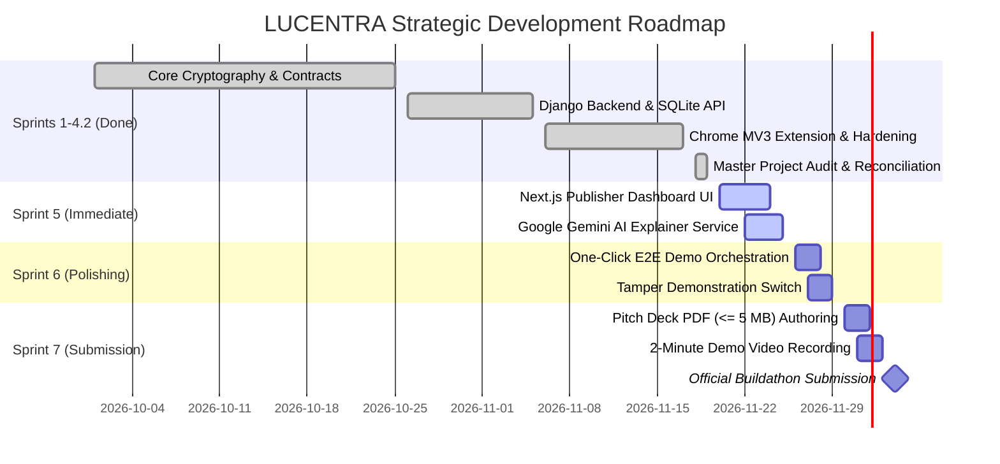

# LUCENTRA — Comprehensive Gap Analysis & Strategic Roadmap

**Document ID:** LUC-AUD-008  
**Version:** 1.0.0  
**Classification:** STRATEGIC ROADMAP & TECHNICAL DEBT AUDIT  
**Audit Date:** 2026-11-19  
**Auditor:** Principal Software Architect & Product Strategist  
**Repository Path:** `C:\Users\mustafa\Desktop\LUCENTRA`  
**Git Branch:** `security/sprint-4-2-hardening`  
**Target Milestone:** Startup Buildathon India 2026  

---

## 1. Executive Summary

This document consolidates the technical, architectural, and business gaps identified across the LUCENTRA platform. It outlines a concrete, phased strategic roadmap from our current hardened protocol state through the **Startup Buildathon India 2026** submission and post-hackathon commercialization.

---

## 2. Multi-Layer Technical Gap Analysis

```
+-----------------------------------------------------------------------------------------------+
|                                LUCENTRA SEVEN-LAYER GAP ANALYSIS                              |
+-----+-------------------------+------------+--------------------+-----------------------------+
| #   | Layer                   | Maturity   | Current Reality    | Primary Gap                 |
+-----+-------------------------+------------+--------------------+-----------------------------+
| L1  | Cryptography & Core     | 100%       | Production Grade   | Minor: CLI package wrapper  |
| L2  | Smart Contracts & EAS   | 95%        | Audited on Anvil   | Sepolia live deployment     |
| L3  | Django Backend API      | 90%        | Functional REST    | Redis caching & rate limits |
| L4  | Chrome Extension MV3    | 90%        | Hardened & Built   | Interactive desktop QA      |
| L5  | Publisher Dashboard UI  | 0%         | Specification Only | Missing entire Next.js app  |
| L6  | Multi-Party Witness     | 0%         | Specification Only | Missing witness consensus   |
| L7  | Google AI Integration   | 0%         | Blueprint Ready    | Missing Gemini SDK code     |
+-----+-------------------------+------------+--------------------+-----------------------------+
```

### Layer-by-Layer Findings:

1. **Layer 1: Cryptography & Protocol Core (`packages/core`)**
   - *Status:* **COMPLETE.** Implements RFC 8785 (JCS), SHA-256 (FIPS 180-4), EIP-712 structured signing, UTS #46 domain normalization, and release completeness verification. 66 passing tests.
   - *Gap:* `packages/cli` is an empty directory; publisher CLI commands currently invoke `packages/core/src/cli.ts` directly.

2. **Layer 2: Smart Contracts & On-Chain EAS (`contracts/`)**
   - *Status:* **COMPLETE.** Solidity 0.8.24 contracts (`PublisherRegistry.sol`, `SignatureVerifier.sol`, `ReleaseAttestationVerifier.sol`) integrated with EAS v1.3.0. 79 passing Foundry tests.
   - *Gap:* Tested and deployed only to local Anvil (Chain ID 31337). Public Sepolia testnet deployment scripts and verified Etherscan contracts are pending.

3. **Layer 3: Backend Infrastructure (`services/backend/`)**
   - *Status:* **COMPLETE.** Django REST Framework with SQLite persistence, DNS ownership challenge engine, immutable audit event log, and subprocess blockchain bridge. 54 passing tests.
   - *Gap:* Missing Celery asynchronous task broker (currently runs synchronous eager tasks) and Redis-backed rate limiting on public verification endpoints.

4. **Layer 4: Chrome Browser Extension (`apps/extension/`)**
   - *Status:* **COMPLETE & HARDENED.** Manifest V3 extension featuring fail-closed redirect rejection (`redirect: "error"`), binary bitmask IPv4-mapped IPv6 SSRF defense, streaming reader early cancellation, monotonic tab-session race defense, and popup caution flags. 61 passing tests.
   - *Gap:* Automated tests run in Node.js mock DOM; interactive manual testing in live desktop Chromium remains to be conducted. Build tooling contains an `esbuild` dev dependency vulnerability (`GHSA-67mh-4wv8-2f99`).

5. **Layer 5: Publisher Dashboard (`apps/dashboard/`)**
   - *Status:* **NOT IMPLEMENTED (0%).** Directory is empty.
   - *Gap:* Publishers have no graphical Web3 dashboard to connect wallets, register domains, generate DNS tokens, or sign release manifests.

6. **Layer 6: Multi-Party Witness Network (`services/witness/`)**
   - *Status:* **NOT IMPLEMENTED (0%).** Directory is empty.
   - *Gap:* Witness observation consensus is deferred to post-MVP roadmap.

7. **Layer 7: Google AI Stack Integration**
   - *Status:* **NOT IMPLEMENTED (0%).**
   - *Gap:* No Gemini API endpoints, Google AI Studio fine-tuned prompts, or Google Agent Skills currently exist in the codebase.

---

## 3. Four-Phase Strategic Roadmap



---

## 4. Phase Breakdown & Deliverables

### Phase 1: Sprint 5 — Publisher Dashboard & Google Gemini AI Explainer
- **Primary Objectives:**
  1. Initialize Next.js 14 in `apps/dashboard/` with Tailwind CSS, Wagmi v2, and RainbowKit.
  2. Implement Publisher Onboarding UI:
     - Connect Wallet (MetaMask / Coinbase).
     - Enter Domain and click "Generate DNS TXT Challenge".
     - Display DNS verification status in real time.
     - Authorize signing key via EIP-712 signature popup.
     - Upload script bundle, auto-generate `LUCENTRA-Manifest-v0.1`, sign, and attest.
  3. Implement `services/backend/apps/ai/`:
     - Install `google-genai` Python SDK.
     - Create endpoint `GET /api/v1/domains/{domain}/explain/` calling `gemini-3.8-flash`.
     - Ingest structured verification evidence, enforce Pydantic output schema, and return plain-English explanations.
- **Deliverables:** Working publisher dashboard, functional Gemini API endpoint, automated tests.

### Phase 2: Sprint 6 — Extension AI Copilot & One-Click Demo Orchestration
- **Primary Objectives:**
  1. Update Chrome extension popup to query the backend Gemini explainer endpoint, rendering an interactive "AI Security Insights" badge.
  2. Author `scripts/demo-e2e.ps1` to orchestrate background Anvil, contract migration, Django backend, demo static web server, and launch Edge with the extension loaded.
  3. Add a "Tamper Demo Switch" to the test site: allows toggling between authentic and tampered JavaScript to visually demonstrate the extension instantly catching Magecart attacks.
- **Deliverables:** Seamless one-click demo script, interactive AI security advice in popup.

### Phase 3: Sprint 7 — Startup Buildathon Submission Package
- **Primary Objectives:**
  1. Author the official 10-slide Pitch Deck PDF (<= 5 MB) following the prescribed template.
  2. Record a high-definition 2-minute product walkthrough video showing the publisher dashboard, blockchain attestation, extension verification, and Gemini explanation.
  3. Deploy smart contracts to Ethereum Sepolia testnet and record verified contract addresses.
  4. Submit application through the official Buildathon India 2026 portal.
- **Deliverables:** Submission confirmation, Pitch Deck PDF, public GitHub repository tagged at `v0.1.0-buildathon`.

### Phase 4: Post-Buildathon — Commercialization & Protocol Scaling
- **Primary Objectives:**
  1. Implement Multi-Party Witness Consensus (`services/witness/`).
  2. Migrate Smart Contracts to Arbitrum / Base L2 rollups for sub-cent attestation gas costs.
  3. Introduce B2B Enterprise SOC 2 / PCI-DSS 4.0 Section 6.4.3 automated compliance reporting.

---

## 5. Technical Debt & Dependency Remediation Plan

| Item | Component | Current State | Remediation Strategy | Target Sprint |
| :--- | :--- | :--- | :--- | :--- |
| **Vite / esbuild Advisory** | `apps/extension` | Moderate vulnerability (GHSA-67mh-4wv8-2f99) in dev server | Upgrade `vite` to v6.x and `esbuild` to >= 0.25.0 once stable | Sprint 6 |
| **Empty CLI Directory** | `packages/cli` | Empty directory | Export bin script wrapping `packages/core/src/cli.ts` | Sprint 6 |
| **SQLite Concurrency** | `services/backend` | Single-writer SQLite | Maintain for local demo; add PostgreSQL Docker compose profile for enterprise deployment | Post-Buildathon |
| **E2E Live Anvil Tests** | Core & Backend | 2 skipped tests due to inactive Anvil | Ensure `demo-e2e.ps1` boots Anvil before running integration suite | Sprint 6 |

---

## 6. Strategic Audit Conclusion

LUCENTRA possesses an exceptional cryptographic and smart contract foundation. The gaps identified in this audit are standard for an infrastructure protocol transitioning from cryptographic proof-of-concept to user-facing prototype.

By executing **Sprint 5 (Publisher Dashboard & Gemini Explainer)** and **Sprint 6 (One-Click Demo Orchestration)**, LUCENTRA will transform into a visually captivating, technically indisputable submission that represents the absolute frontier of what can be built on the Google AI and decentralized web stack.

