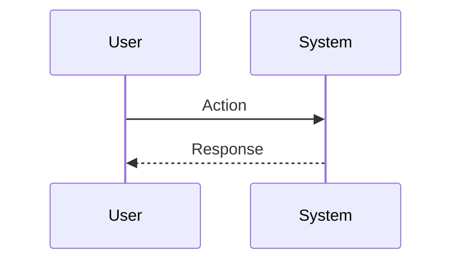

# Feature Specification Template

**Document ID:** SPEC-XXX  
**Feature Name:** [Feature Title]  
**Status:** [PROPOSED | APPROVED | IN_PROGRESS | IMPLEMENTED | VERIFIED]  
**Author:** [Role / Name]  
**Target Release:** [e.g., v0.1.0]  

---

## 1. Problem Statement & Motivation
[Why is this feature needed? What user or system pain point does it address?]

---

## 2. User Stories & Personas
- **As a** [Publisher / Extension User / Witness Operator],  
  **I want to** [perform an action],  
  **So that** [achieve a specific outcome].

---

## 3. Technical Design

### 3.1 Architecture & Data Flow

### 3.2 Interfaces & Contracts
[API endpoints, Solidity interfaces, or TypeScript types]

### 3.3 Database Changes
[Schema migrations, new tables, or fields]

---

## 4. Security Considerations
- [Threat vectors analyzed]
- [Input validation rules]
- [Permission and role requirements]

---

## 5. Acceptance Criteria
- [ ] Criterion 1
- [ ] Criterion 2
- [ ] Criterion 3

